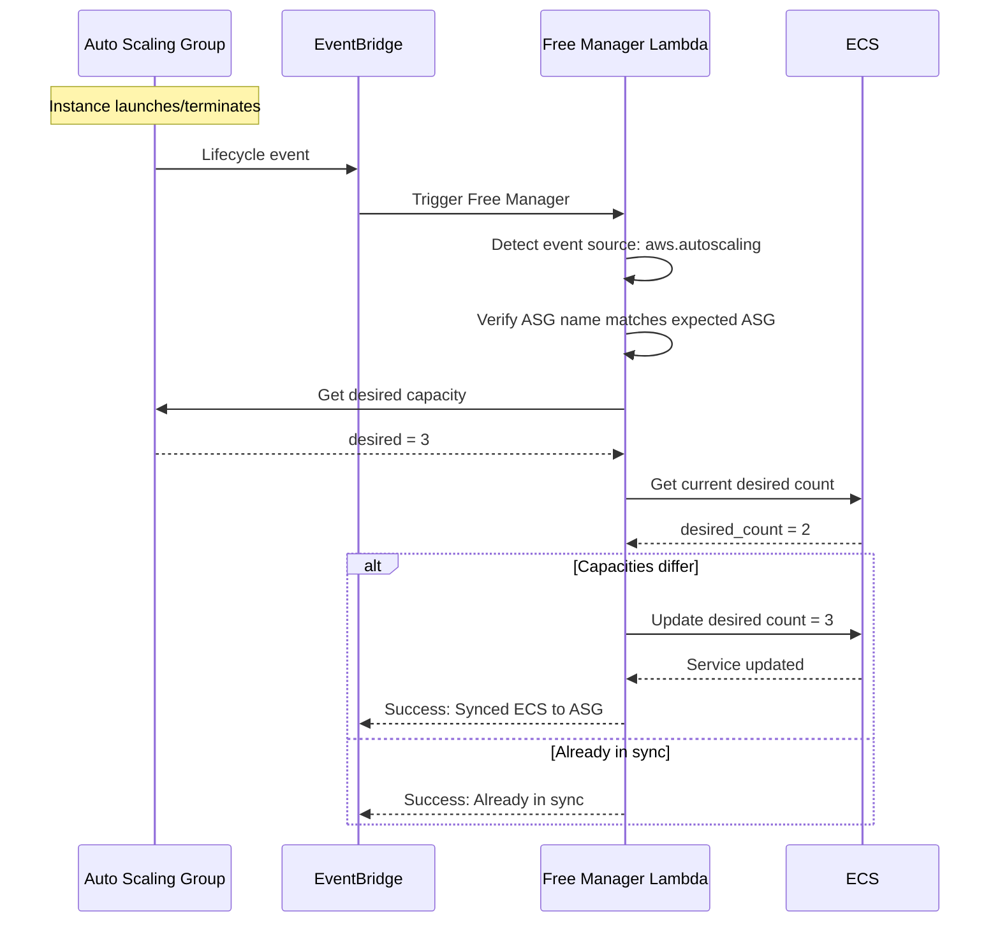
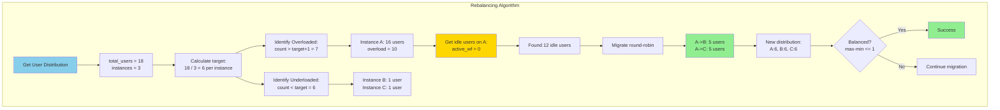

# Free Manager: Auto-Scaling and Load Rebalancing for Free Tier Users

## Executive Summary
- **Free Manager** handles auto-scaling and load rebalancing for free tier users
- **ASG-based architecture** using Auto Scaling Groups instead of individual EC2 instances
- **Capacity by active user count, in both directions** — the target is computed on every run; this Lambda is the only thing that removes a free instance
- **The load alarms only add** — `cpu-high` / `memory-high` may launch an instance the user count under-estimated; there is no scale-down alarm
- **Scale-in chooses by workload** — never an instance running a workflow, then the one with the fewest active users
- **ASG bounds are authoritative** — the instance target is clamped to the group's own `MinSize`/`MaxSize`, so capacity is adjusted on the ASG, not in this Lambda
- **Traffic distribution is the ALB's**, not this Lambda's — round robin plus sticky sessions; rebalancing only updates the assignment records
- **Workflow protection** ensures users with active jobs are never migrated, and never the ones whose instance a scale-in removes
- **Experiment sync** automatically syncs experiment metadata after migration

> **Scope note:** this document covers the free tier's *instance count*. How
> much work a single instance can absorb is a separate concern. Known defects
> in the current behaviour are tracked in #933 and #934, not here.

## Key Architectural Principles

1. **Activity-Based Scaling, both directions**
   - Monitors active user count (activity within 5 minutes)
   - Calculates instances needed: `ceil(active_users / 5)`, on every run at
     any count — 0 users ask for `MinSize`
   - Clamped to the ASG's `MinSize`/`MaxSize`, read from the group on every run
   - Scale-out raises the ASG; scale-in terminates instances this Lambda
     chooses (see *Scale-in* below). Published as `TargetInstances`

2. **Proactive Rebalancing**
   - Distributes users evenly across ALL instances (not just most/least loaded)
   - Also rebalances when distribution is imbalanced without scaling
   - Waits for new instances with retry (max 17 min in code, Lambda timeout 15 min)
   - Updates the `instance_id` on idle users' assignment records, round-robin
   - Verifies distribution is balanced after migration (max-min <= 1)
   - **This does not move traffic** — see
     [What rebalancing does and does not do](#what-rebalancing-does-and-does-not-do)

3. **Job Preservation — reassignment and the Lambda's own scale-in**
   - Database field: `active_workflow_count` tracks running jobs
   - SQL constraint: Migration query includes `WHERE active_workflow_count = 0`
   - Atomic updates: Users with jobs cannot be **reassigned** (SQL-level guarantee)
   - **Scale-in never removes an instance with a running workflow.** The
     Lambda sums `active_workflow_count` per instance over every assignment
     row and excludes any instance above 0; if that leaves too few safe
     candidates, the surplus stays up until the workflows finish
   - **A count that never decrements holds its instance** (an OOM kill, an
     agent crash, a task stopped mid-workflow) until the Common User
     Manager's sweep resets it: every 10 minutes, for a user inactive for
     2 hours whose workflow started over 4 hours ago. So a surplus can be
     held for about 4 hours, visible as `TargetInstances` below desired on
     the dashboard and a `kept` line in the log
   - **Other terminations are not covered.** Nothing stops the ASG itself
     terminating a busy instance on a health-check replacement, an
     availability-zone rebalance, or a manual `--desired-capacity` or a
     `--max-size` lowered below it: `protect_from_scale_in = false`, and the
     capacity provider's `managed_termination_protection = "DISABLED"`.
     Those paths are rare now that no alarm and no procedure lowers the
     desired capacity by hand
   - ECS managed draining runs on every termination (the group carries the
     `AmazonECSManaged` tag it needs), but it does not save a workflow: the
     free service's `deployment_minimum_healthy_percent = 0` lets ECS stop the
     task without waiting for a replacement
   - `termination_policies = ["NewestInstance"]` applies only to those other
     paths, since the Lambda names the instance it terminates. The sticky
     cookie is re-issued on every response, so active users stay on the
     instance they started on, and the newest instance holds only sessions
     placed since it launched. It does not look at workload
   - A terminated instance is released in about 9 minutes: the target group's
     300 s deregistration delay, then ECS's draining hook, which ECS completes
     a few minutes after the task has stopped. Nothing else holds it: the
     group's former terminate hook, which held every termination for a 300 s
     timeout, is retired (see [Lifecycle Hooks](#lifecycle-hooks))
   - That depends on the instance's ECS agent reaching ECS, through NAT (there
     are no ECS VPC endpoints). If it cannot report its task stopped, ECS keeps
     renewing the draining hook, and the instance is held until connectivity
     returns or the hook's 48-hour limit — not the hook's one-hour timeout

4. **Sticky Session Compatibility**
   - Works with ALB sticky sessions (5-minute cookies)
   - Users migrate within 5 minutes after rebalancing (cookie expires)
   - No user-visible disruption during migration

5. **Post-Migration Experiment Sync**
   - After successful migration, triggers experiment metadata sync on new instance
   - Calls internal API endpoint (`/system-internal/sync-experiments/{user_id}`)
   - Fire-and-forget: migration succeeds even if sync fails

6. **ASG Configuration as the Single Source of Truth**
   - The instance floor and ceiling are read via
     `describe_auto_scaling_groups` each run, not held in this Lambda's
     environment
   - Capacity is therefore adjusted on the ASG (Terraform, console or CLI)
     without redeploying this function

## Architecture Overview

```mermaid
graph TB
    subgraph "User Activity Flow"
        A[User HTTP Request] --> B[UserActivityMiddleware]
        B --> C[Update free_user_assignments]
        C --> D[Track: last_activity, instance_id, active_wf]
    end

    subgraph "Free Manager Lambda (Every 5 min)"
        E[Scheduled Trigger] --> F[Count Active Users<br/>Target = ceil(users / 5)<br/>within MinSize..MaxSize]
        F -->|target > desired| G[Scale ASG out]
        F -->|target <= desired - 2| H[Scale in: terminate<br/>instances with no workflow,<br/>fewest users first]
        F -->|otherwise| H2[Rebalance if imbalanced]

        G --> I[Wait for Instances<br/>within remaining time]
        I --> J[Get Available Instances]
        J --> K[Rebalance Users<br/>Multi-Instance Algorithm]
        K --> L[Verify Distribution]
    end

    subgraph "ASG Lifecycle Events"
        M[ASG Scale Event] --> N[Immediate ECS Sync]
        N --> O[Update ECS desired count]
    end

    subgraph "Rebalancing Logic"
        K --> P[Calculate Target:<br/>total_users / num_instances]
        P --> Q{Find Overloaded<br/>count > target+1}
        Q --> R[Get Idle Users<br/>active_wf = 0]
        R --> S[Migrate Round-Robin<br/>to Underloaded]
        S --> T[Update DB instance_id]
        T --> V[Trigger Experiment Sync<br/>on New Instance]
    end

    D --> F
    V --> U[User Next Request<br/>Routes to New Instance]

    style G fill:#90EE90
    style K fill:#FFD700
    style R fill:#87CEEB
    style T fill:#DDA0DD
```

### One Owner of Scale-in, Two Ways to Scale Out

The free ASG's desired capacity is **lowered by one writer only**, this
Lambda. A second writer, in `monitoring.tf`, may still **raise** it.

| | This Lambda — user count | Load alarms — instance load |
|---|---|---|
| Driven by | A 5-minute schedule | CloudWatch alarms on the free ECS service |
| Input | Active user count from `free_user_assignments` | `AWS/ECS` `CPUUtilization` / `MemoryUtilization` |
| Direction | Out **and in** | Out only: `cpu-high` / `memory-high` → `scale_up`, +1 |
| Mechanism | `SetDesiredCapacity` to the target; `TerminateInstanceInAutoScalingGroup` with a decrement, for an instance it chose | Simple scaling policy |
| Defined in | `free_manager.tf`, `free_manager.py` | `monitoring.tf`, `compute.tf` |

- **Why one owner.** Two writers that both lower capacity undo each other: a
  load alarm drained what the user count had just added, and each drain took
  the instance the group's policy chose, blind to workloads. With scale-in
  in one place it is driven by the same signal as scale-out, it returns the
  group to `MinSize` in one run, and the instance removed is chosen by
  workload. An instance a `-high` alarm added is removed the same way once
  the alarm has been out of ALARM for 15 minutes and the user count does
  not need it (see [Conservative Scale-Down](#6-conservative-scale-down));
  until then this Lambda removes nothing.
- **The load metrics are service-level.** For an EC2-launch-type service,
  `CPUUtilization` is utilization of the CPU units *reserved by the task*,
  averaged across the service. Work that stalls on I/O does not move it; the
  `high-iowait` alarm notifies but does not scale.
- **Nothing else moves the ASG.** There is no `cpu-low` / `memory-low` alarm
  and no scale-down policy. The capacity provider's `managed_scaling` is
  `DISABLED`, and ECS Application Auto Scaling is commented out in
  `compute.tf` because it raced against this Lambda.
- Both are bounded by the group's `MinSize`/`MaxSize`.
- **What to watch.** `TargetInstances` (this Lambda's target) is plotted with
  `GroupDesiredCapacity` on the dashboard. Desired above target for longer
  than a run is a scale-in the Lambda could not make safely — a workflow on
  every candidate — or an instance a `-high` alarm added; desired below
  target is a scale-out that has not happened.

### Scaling Strategy Matrix

Formula: `instances = min(max(MinSize, ceil(active_users / 5)), MaxSize)`

`MinSize` and `MaxSize` are the ASG's own, read from the group on every run.
The table below shows the user-count term alone; the actual target is that
value pulled up to `MinSize` or down to `MaxSize`.

| Active Users | User-count term | Action |
|-------------|------------------|--------|
| 0-5 | 1 | 1 instance (with `MinSize` ≥ 1); scale in to it by the rules below |
| 6-10 | 2 | Scale to 2, rebalance |
| 11-15 | 3 | Scale to 3, rebalance |
| 16-20 | 4 | Scale to 4, rebalance |
| 21-25 | 5 | Scale to 5, rebalance |
| 26-30 | 6 | Scale to 6, rebalance |
| 31+ | `ceil(users / 5)` | Scale up, rebalance |

Notes:
- Every row is reachable in both directions: the target is computed on every
  run, at any user count, so the group returns to its baseline when users
  leave.
- `MinSize` above the term holds the target there; a term above `MaxSize` is
  capped, not requested.
- A surplus of 2 or more is removed at once; a surplus of 1 once it has shown
  in three completed periods; nothing while a `-high` alarm is in ALARM or
  left it less than 15 minutes ago — see
  [Conservative Scale-Down](#6-conservative-scale-down).

### Motivation: Sticky Session Overload

Without Free Manager, a burst of users all land on the instances that exist
at that moment and hold sticky session cookies to them. The ASG may launch
more instances, but nothing provisions them *ahead* of the burst, so the
capacity arrives after the congestion.

Free Manager addresses the capacity half of that: it tracks activity in the
database and raises the ASG's desired capacity before the user count has
overwhelmed the running instances. Users with active workflows are protected
from reassignment by atomic SQL constraints, and experiment metadata is
synced to new instances after reassignment.

### What rebalancing does and does not do

**Traffic distribution is the load balancer's job, not this Lambda's.**

- Free-tier requests reach the free target group through one shared listener
  rule (the `Authorization: Bearer *` catch-all). Unlike premium, there are
  **no per-user routing rules**.
- The target group sets no `load_balancing_algorithm_type`, so the AWS default
  **round robin** applies, with `lb_cookie` stickiness. Targets are registered
  both by the ASG and by ECS (`instance:8000`).
- `migrate_user_to_instance` **only updates `free_user_assignments.instance_id`**.
  It does not change ALB routing, and `UserActivityMiddleware` overwrites that
  column with whichever instance actually served the next request.

So rebalancing is bookkeeping plus the experiment-sync trigger. Redistribution
happens when a session is new, or when its sticky cookie lapses.

**The cookie's duration is an inactivity window, not a lifetime** — the ALB
refreshes it on each response, so a polling client never expires it. Hence:

- An **already-active user is not moved onto newly added instances.** New
  sessions, and users who return after going idle, land on new capacity.
- Raising capacity buys a larger rotation, not a per-instance quota: round
  robin counts requests rather than users, and each ALB node keeps its own
  rotation, so a small sample spreads evenly in expectation rather than
  exactly.

### Procedure: Pre-provisioning Capacity for an Expected Burst

Reactive scaling cannot serve the first wave of a burst — a 5-minute polling
interval, instance boot, and sticky sessions that keep active users put.

1. **Size it.** Minimum = `ceil(expected concurrent users / 5)`, "concurrent"
   meaning a request within `FREE_IDLE_THRESHOLD_MINUTES`. **Raise
   `asg_max_size` first if the target exceeds it** — it is a cap the Lambda
   clamps to, and `MinSize <= MaxSize` must hold. **Raise the minimum, never
   `desired` alone:** a desired capacity above the user-count target is a
   surplus, and the Lambda removes a surplus of 2 or more on its next run.
2. **Allow 30 minutes.** Instance boot, then task placement and two health
   checks at 60-second intervals.
3. **Choose a route.** `asg_min_size` in tfvars is durable; a console or CLI
   override takes effect at once but **the next apply removes the floor**
   (`min_size` is not under `ignore_changes`). So freeze applies for the
   window, or re-apply the override straight after.
   - An apply does not remove the instances — `desired_capacity` is ignored,
     so they stay up. It removes the *floor*, after which this Lambda scales
     the group in to what the user count needs, within one run. **Instances
     still running after an apply is not evidence the window is safe.**
4. **Check the chain** once settled. `HEALTH-03` and `HEALTH-05` assert it, and
   `free-manager-errors` should read `OK`:
   ```
   ASG DesiredCapacity == ASG InService == ECS runningCount == healthy targets
   ```
5. **Restore the floor first, the ceiling last.** Lower `min_size` and leave
   the desired capacity alone: the next scheduled run computes the target
   from the user count and removes the surplus, choosing instances with no
   running workflow. Lowering `--desired-capacity` by hand would have the
   group choose instead, blind to workloads — and so would lowering
   `--max-size` below the current desired, since `UpdateAutoScalingGroup`
   then sets desired to the new maximum. If `asg_max_size` was raised for
   the event, lower it only once desired is at or below the old value.

```bash
aws autoscaling update-auto-scaling-group --auto-scaling-group-name <asg> \
  --min-size <original> --region <region>
```

   Expect the group at `<original>` within about 15 minutes when the surplus
   is 2 or more: one run (up to 5 minutes) plus the ~10-minute termination.
   A surplus of exactly 1 waits for three completed periods first, so about
   20 minutes more. If it stays above, read the Lambda's log — a workflow
   on every candidate holds the instance until it finishes, and a `-high`
   alarm in ALARM holds everything.

### Flow Diagrams

#### Scheduled Monitoring Flow (Every 5 Minutes)

```mermaid
sequenceDiagram
    participant CW as CloudWatch Events
    participant FM as Free Manager Lambda
    participant DB as Database
    participant ASG as Auto Scaling Group
    participant ECS

    CW->>FM: Trigger (every 5 min)
    FM->>ECS: Resync desired count to the ASG (raise only)
    FM->>DB: Count active users (last_activity < 5 min)
    DB-->>FM: active_count = 18
    FM->>CW: Publish metric: ActiveLogins=18

    FM->>FM: Calculate target: ceil(18/5) = 4 instances
    FM->>ASG: Get current capacity (via get_service_info)
    ASG-->>FM: current = 2 instances
    FM->>CW: Publish metric: TargetInstances=4

    alt Need to scale up
            FM->>FM: Set scaling lock
            FM->>ASG: Set desired capacity = 4
            FM->>ECS: Update desired count = 4
            ASG-->>FM: Scaling initiated

            FM->>FM: Wait for instances (retry every 60s)
            loop Until ready or the invocation's time is nearly up
                FM->>ECS: Check running tasks
                ECS-->>FM: running_count = 3
                alt All instances ready
                    FM->>FM: Break - instances ready
                else Still launching
                    FM->>FM: Wait 60s, retry
                end
            end

            FM->>FM: Rebalance users across 4 instances
            FM->>DB: Get user distribution
            DB-->>FM: Instance A: 18, B: 0, C: 0, D: 0

            FM->>DB: Get idle users (active_wf = 0)
            DB-->>FM: 14 idle users on Instance A

            FM->>DB: Migrate users round-robin
            Note over FM,DB: A->B: 4 users<br/>A->C: 5 users<br/>A->D: 5 users

            FM->>DB: Verify distribution
            DB-->>FM: A:4, B:4, C:5, D:5 (balanced)

            FM->>FM: Clear scaling lock

        else Target at least 2 below desired (scale in)
            FM->>DB: Active users and running workflows per instance
            DB-->>FM: A: 3 users / 0 wf, B: 0 / 1 wf, C: 0 / 0 wf, D: 1 / 0 wf
            FM->>FM: Exclude B (workflow); order C, D, A
            FM->>ASG: TerminateInstanceInAutoScalingGroup(C, decrement)
            FM->>ASG: TerminateInstanceInAutoScalingGroup(D, decrement)
            Note over FM,ECS: ECS is lowered by each<br/>terminate event, not here

        else No scaling needed but imbalanced
            FM->>FM: Rebalance without scaling
        end
```

#### ASG Lifecycle Event Flow



#### Multi-Instance Rebalancing Algorithm



---

## Implementation Details

### 1. Middleware: Activity Tracking

#### UserActivityMiddleware

**File:** `studio/app/common/core/middleware/user_activity_middleware.py`
**Purpose:** Track user activity and instance assignment for both
free and premium tiers. Aliased as `FreeUserActivityMiddleware`
for backwards compatibility.
**Input:** ASGI scope (HTTP request with JWT Authorization header)
**Output:** Updates `free_user_assignments` or
`premium_user_assignments` table via async background task
**Calls:** `extract_uid_from_firebase_jwt()` ->
`_get_user_id_and_tier()` ->
`_update_free_user_activity_async()` or
`_update_premium_user_activity_async()`

Performance optimizations:
- In-memory cache (60s TTL) throttles DB writes to once/min/user
- User tier cache (5 min TTL) avoids repeated subscription lookups
- Instance ID cached at startup (fetched once from EC2 metadata)

**Instance ID Resolution:**
The middleware first checks the `INSTANCE_ID` environment variable,
then falls back to IMDSv2 metadata service (with IMDSv1 fallback).
The result is cached at startup. Returns "local" in development
(skips DB update).

**`instance_id` while a workflow runs:** the activity UPDATE moves
`instance_id` to the serving instance only while
`active_workflow_count` is 0. With a workflow running the column keeps
naming the host the workflow runs on (pinned by
`increment_workflow_count()`), so a request served elsewhere — a second
tab, a new session after the sticky cookie lapsed — does not make the
free scale-in treat that host as free of work.

### 2. Free Manager Lambda

**File:** `infrastructure/terraform/free_manager_package/free_manager.py`

#### handler()

**File:** `infrastructure/terraform/free_manager_package/free_manager.py`
**Purpose:** Main Lambda entry point supporting dual triggers
(CloudWatch scheduled events and ASG lifecycle events)
**Input:** Lambda event dict and context; routes on
`event["source"]`
**Output:** Dict with statusCode and JSON body describing
actions taken
**Calls:** `handle_asg_event()` or
`handle_scheduled_monitoring()` based on event source

#### handle_scheduled_monitoring()

**File:** `infrastructure/terraform/free_manager_package/free_manager.py`
**Purpose:** Periodic monitoring (every 5 minutes) -- resyncs
ECS to the ASG, counts active users, computes the instance
target at any user count and acts on it, rebalances users
across instances, publishes CloudWatch metrics
**Input:** Lambda event and context (scheduled trigger); the
context bounds the scale-out wait
**Output:** Dict with scaling/rebalancing results
**Calls:** `sync_ecs_to_asg()` -> `count_active_free_users()` ->
`publish_active_user_metric()` -> `scale_and_rebalance()`

#### scale_and_rebalance()

**File:** `infrastructure/terraform/free_manager_package/free_manager.py`
**Purpose:** Scale the ASG to the user count and rebalance idle
users. Handles three scenarios: scale out (with instance wait
loop), scale in through `scale_in()` — a surplus of 2 or more at
once, a surplus of 1 once `surplus_of_one_has_persisted()`, and
neither while `load_alarm_holds_capacity()` — and rebalance-only when
distribution is imbalanced. Returns the target as
`desired_instances` on every path, the lock-held one included;
`handle_scheduled_monitoring()` publishes it once the whole run
has succeeded.
**Input:** `active_user_count`, `context`, `scheduled_at`
**Output:** Dict with scaling action, terminated instances,
migrated users, and balance status. Uses CloudWatch metric lock
to prevent concurrent scale-outs.
**Calls:** `get_service_info()` -> `calculate_desired_instances()`
-> `is_scaling_in_progress()` ->
`scale_service()` or `scale_in()` -> `get_available_instance_ids()`
-> `rebalance_idle_users_multi()` -> `is_distribution_balanced()`

The bounds are not an input: they come from `get_service_info()`,
which reads them off the ASG.

#### scale_in() and select_instances_to_terminate()

**File:** `infrastructure/terraform/free_manager_package/free_manager.py`
**Purpose:** Remove `desired - target` instances, chosen by
workload. `select_instances_to_terminate()` is pure: it drops
any instance that is not `InService`, is protected, or has a
running workflow (`get_workload_per_instance()`, summed over
every assignment row), then orders the rest by fewest active
users, the availability zone holding the most instances
(recounted after each pick, so two picks never come from one
zone when another has as many), and the newest launch. If too
few are safe, only those are chosen; the surplus waits for a
later run. `scale_in()` terminates each with
`TerminateInstanceInAutoScalingGroup` and
`ShouldDecrementDesiredCapacity`, so the group never chooses an
instance itself; a refused call is logged and retried next run.
**Input:** `get_service_info()["instances"]`, count
**Output:** Instance ids whose termination was accepted
**Calls:** `get_users_per_instance()` ->
`get_workload_per_instance()` -> `ec2_client.describe_instances()`
-> `select_instances_to_terminate()` ->
`autoscaling_client.terminate_instance_in_auto_scaling_group()`

ECS is not lowered here. The terminate events lower it to the
instances still in the group, as for any other termination
(Edge Case 4).

#### scale_up_wait_budget()

**File:** `infrastructure/terraform/free_manager_package/free_manager.py`
**Purpose:** Seconds the scale-out wait loop may run in this
invocation: the remaining time less a 60 s margin, capped at
`MAX_WAIT_TIME` (1020 s). The constant alone exceeds the 900 s
function timeout, and a loop the platform kills never runs the
`finally` that clears the scaling lock.
**Input:** Lambda context (anything without
`get_remaining_time_in_millis()` falls back to the constant)
**Output:** Seconds, at least 0

#### calculate_desired_instances()

**File:** `infrastructure/terraform/free_manager_package/free_manager.py`
**Purpose:** Turn an active user count into a target instance
count, clamped to the ASG's bounds. Pure function, no AWS calls.
**Input:** `active_user_count`, `asg_min_size`, `asg_max_size`
**Output:** Target instance count within `[asg_min_size, asg_max_size]`

```python
desired = min(max(asg_min_size, ceil(active_users / USERS_PER_INSTANCE)), asg_max_size)
```

`SetDesiredCapacity` rejects anything outside the group's bounds,
and a rejection aborts the invocation, so clamping here is what
keeps a cycle's rebalancing and metrics from being lost as well.

Wait loop retries every 60s, within the budget from
`scale_up_wait_budget()`. Rebalancing is retried on the next
Lambda run if not completed.

#### scale_service()

**File:** `infrastructure/terraform/free_manager_package/free_manager.py`
**Purpose:** Scale the ASG and ECS service **out** together. Sets
ASG desired capacity directly (`HonorCooldown=False` for
immediate scaling), then updates ECS desired count to match.
This manual approach prevents runaway scaling from ECS managed
scaling (CPU spike cascades). Scale-in does not come through
here: lowering the desired capacity would leave the choice of
instance to the group's termination policy.
**Input:** `cluster_name`, `service_name`, `desired_count`,
`current_ecs_desired`
**Output:** None (side effect: ASG and ECS capacity updated)
**Calls:** `autoscaling_client.set_desired_capacity()` ->
`ecs_client.update_service()`

#### get_service_info()

**File:** `infrastructure/terraform/free_manager_package/free_manager.py`
**Purpose:** Get current ASG and ECS service information.
Returns ASG desired capacity as source of truth for scaling,
its bounds, its instances, plus ECS running/pending counts.
**Input:** `cluster_name`, `service_name`
**Output:** Dict with `desired_count`, `min_size`, `max_size`
and `instances` (from ASG), `running_count`, `pending_count`
and `ecs_desired_count` (from ECS)
**Calls:** `autoscaling_client.describe_auto_scaling_groups()`
-> `ecs_client.describe_services()`

#### get_available_instance_ids()

**File:** `infrastructure/terraform/free_manager_package/free_manager.py`
**Purpose:** Get list of RUNNING EC2 instance IDs from ECS
cluster. Three-step verification: list container instances
(ACTIVE, DRAINING, REGISTERING), filter for connected ECS
agents, verify EC2 state is 'running'.
**Input:** `cluster_name`, `service_name`
**Output:** List of EC2 instance IDs that are fully ready to
handle traffic
**Calls:** `ecs_client.list_container_instances()` ->
`ecs_client.describe_container_instances()` ->
`ec2_client.describe_instances()`

### 3. Multi-Instance Rebalancing

#### rebalance_idle_users_multi()

**File:** `infrastructure/terraform/free_manager_package/free_manager.py`
**Purpose:** Rebalance idle users across ALL available
instances using round-robin distribution from overloaded
to underloaded instances
**Input:** `available_instances` (list of instance IDs)
**Output:** List of migrated user IDs
**Calls:** `get_users_per_instance()` ->
`get_idle_users_for_instance()` ->
`migrate_user_to_instance()`

Algorithm:
1. Calculate target users per instance (even distribution)
2. Identify overloaded instances (count > target + 1)
3. Identify underloaded instances (count < target)
4. Migrate idle users from overloaded to underloaded
   (round-robin)

Key constraint:
```python
# Only users with no active workflows can be migrated
idle_users = get_idle_users_for_instance(source_inst)
# active_workflow_count = 0
```

### 4. Workflow Protection and Migration

#### migrate_user_to_instance()

**File:** `infrastructure/terraform/free_manager_package/free_user_utils.py`
**Purpose:** Atomic user migration with triple workflow
protection. After successful migration, triggers experiment
metadata sync on the new instance (fire-and-forget).
**Input:** `user_id`, `new_instance_id`
**Output:** True if migration succeeded, False if user has
active workflows or does not exist
**Calls:** SQL UPDATE with constraint ->
`trigger_experiment_sync()`

Key constraint:
```sql
-- Only migrate idle users (atomic protection)
WHERE user_id = %s AND active_workflow_count = 0
```

#### trigger_experiment_sync()

**File:** `infrastructure/terraform/free_manager_package/free_user_utils.py`
**Purpose:** Trigger experiment metadata sync for user on
their new instance. Calls internal API to ensure experiment
metadata is downloaded from S3. Fire-and-forget: migration
succeeds even if sync fails.
**Input:** `user_id` (int)
**Output:** True if sync initiated, False on failure
**Calls:** POST to
`/system-internal/sync-experiments/{user_id}` via ALB

#### get_idle_users_for_instance()

**File:** `infrastructure/terraform/free_manager_package/free_user_utils.py`
**Purpose:** Get list of idle users on a specific instance.
Idle = no active workflows (`active_workflow_count = 0`).
No time-based restriction: users without workflows can be
migrated regardless of last activity time.
**Input:** `instance_id`
**Output:** List of user IDs safe to migrate

> **Terminology note.** "Idle" on the free tier means `active_workflow_count = 0`
> -- a migration-safety check, not an activity cutoff. The premium tier uses
> "idle" in four distinct senses (idle instance, idle premium user, idle /
> stale assignment, idle browser tab), none of which match this definition.
> See the "Disambiguation" section in
> [PREMIUM_USER_ASSIGNMENT.md](./PREMIUM_USER_ASSIGNMENT.md) when reading
> across both documents.

#### get_users_per_instance()

**File:** `infrastructure/terraform/free_manager_package/free_user_utils.py`
**Purpose:** Get count of active users per instance. Only
counts users with activity within threshold (filters by
`last_activity >= cutoff`). Inactive users are not counted
in distribution calculations.
**Input:** `activity_threshold_minutes` (default: 10)
**Output:** Dict mapping `instance_id` -> user count

### 5. Workflow Tracking

#### increment_workflow_count()

**File:** `studio/app/common/core/workflow/workflow_tracking.py`
**Purpose:** Increment `active_workflow_count` when a workflow
starts. Determines user tier (free/premium), then updates the
appropriate assignment table. Falls back to alternative table
if primary does not have a record. For the free tier the same
UPDATE pins `instance_id` to the host the workflow runs on — the
first workflow sets it, a later one does not move it — because
the free scale-in reads that column to spare the host.
**Input:** `user_id`
**Output:** None (side effect: count incremented in DB)

#### decrement_workflow_count()

**File:** `studio/app/common/core/workflow/workflow_tracking.py`
**Purpose:** Decrement `active_workflow_count` when a workflow
completes. Uses `GREATEST(0, count - 1)` to prevent going
below zero, avoiding race conditions.
**Input:** `user_id`
**Output:** None (side effect: count decremented in DB)

---

## Edge Case Handling

### 1. Concurrent Scaling Operations

**Problem:** Multiple Lambda invocations could try to scale simultaneously.

**Solution:** CloudWatch metrics-based locking via
`is_scaling_in_progress()` and `set_scaling_lock()`:
- Checks `ScalingInProgress` metric (15-min window, Maximum stat)
- Set before a scale-out, cleared in `finally` block. Scale-in takes no
  lock: the terminate requests return at once
- Fails open: returns False if check fails (allows scaling)
- The `finally` is reachable because the wait loop is bounded by the
  invocation's remaining time (`scale_up_wait_budget()`). A loop the
  platform killed would leave the lock set for its whole 15-minute window,
  during which every run skips scaling
- A lock-held run still returns its target, and the handler publishes it
  like any other successful run, so a skipped run still reports what it
  wanted. Publishing happens last: a run that fails anywhere leaves no
  datapoint, which the surplus history reads as a hole

### 2. Instances Not Ready in Time

**Problem:** A new instance takes about 8 minutes to a healthy target: the
300 s launch hook, during which it boots and its task is placed, then the
task's start.

**Solution:** Retry logic with a bounded wait. The scale_and_rebalance()
function retries every 60 seconds until the invocation has about a minute
left (`MAX_WAIT_TIME` = 1020 s is the ceiling, the 900 s function timeout
the real bound). Rebalancing will be retried on the next 5-minute Lambda
run if not completed.


### 3. Users With Active Workflows

**Problem:** Migrating a user with running workflow would disrupt their work.

**Solution:** SQL-level protection (atomic check):

```sql
-- Key constraint: only migrate idle users
WHERE user_id = %s
  AND active_workflow_count = 0  -- Atomic protection
```


### 4. ASG and ECS Out of Sync

**Problem:** Manual or alarm-driven ASG scaling changes ASG capacity but not
ECS. An instance the ASG launched with no task on it cannot answer `/health`,
so it is an unhealthy target serving nobody. Terraform does not correct this —
`desired_count` is under `ignore_changes` — so the Lambda is the only thing
that does.

**Solution:** `sync_ecs_to_asg()`, the same rule on every call — launch and
terminate events, and every scheduled run as the backstop for a missed event
(never retried):

```
ECS desired = max(ASG desired, instances still in the group, any lifecycle state)
```

- **Raise** to the ASG's desired capacity when ECS is below it.
- **Lower** only to the number of instances still in the group, never below
  the ASG's desired capacity.

On a launch the first event is `EC2 Instance-launch Lifecycle Action`, sent
by the launch hook as the instance enters `Pending:Wait`; `EC2 Instance
Launch Successful` follows at `InService`. ECS cannot place the task until the
new instance's agent has registered (about 2.5 minutes) and then retries on
its own back-off; the launch hook's 300 s absorbs both, so the target is
registered close to when the task serves.

Why the floor counts instances that are still terminating: on scale-in the
ASG waits out the target group's deregistration delay (300 s) *before* ECS's
draining hook, with the container instance still ACTIVE in ECS. Lowering
while it is in the group would let ECS stop a task chosen by AZ balance —
possibly the survivor's — leaving no healthy target. Once the instance has
left the group its task is already gone, so lowering to the remaining count
stops nothing.

Why a count and not "one less per terminate event": the terminations of a
multi-instance scale-in complete within the same second and their events are
handled concurrently. Two handlers that each read 4 and write 3 leave ECS one
too high for good (observed on development, 2026-10-14, after a 4 → 1
scale-in). The count is idempotent, so the last handler, or the next scheduled
run, converges it. `scale_service()` never lowers ECS at all.


### 5. Unbalanced Distribution After Migration

**Problem:** Migration might not achieve perfect balance (users with active workflows can't be moved).

**Solution:** Verification after migration via
`is_distribution_balanced()`:
- Checks `max(counts) - min(counts) <= tolerance`
- Default tolerance: 1
- If still imbalanced, will retry on next Lambda run


### 6. Conservative Scale-Down

**Problem:** Frequent scale up/down oscillation wastes resources.

**Solution:** two rules, evaluated on every run at any user count.

1. **A surplus of 2 or more goes at once**, all of it, each instance chosen
   by workload. A busy period's capacity comes back to `MinSize` in one
   run rather than one instance per alarm cooldown. The corollary: capacity
   is held by raising `MinSize`, never by raising `desired` alone.
2. **A surplus of exactly 1 goes once it has shown in the 3 completed
   5-minute periods before the run** — on the fourth run that sees it,
   about 15 minutes after the first. This is the boundary case — 5 users
   against 6 — and removing it at once would thrash. The history is read
   from the `TargetInstances` metric this Lambda publishes, against the
   group's `GroupDesiredCapacity`, period by period
   (`surplus_of_one_has_persisted()`); there is no state of its own. The
   periods are aligned to the schedule interval and the current, incomplete
   one is excluded, so the count does not depend on whether this run's own
   datapoint is readable yet. Which period a run belongs to is taken from
   the scheduled event's fire time (`scheduled_period()`), not from the
   clock: the datapoint is published with that period as its timestamp and
   the history is read up to it, so a run that fires seconds before a
   boundary and gets going after it still counts as its own period. A run
   that failed published nothing, so its period is a hole and the wait
   starts over. A desired capacity lowered by hand mid-period counts from
   the next period, one run later. This is how 2 → 1 at `MinSize = 1`
   happens, which no alarm does any more.

**Neither rule applies while `cpu-high` or `memory-high` is in ALARM, nor
for 15 minutes after the alarm's last state change** (`load_alarm_holds_capacity()`,
from the alarm's `StateTransitionedTimestamp`; leaving ALARM is the case
that matters, but any transition starts the quiet period, including
`INSUFFICIENT_DATA` → `OK` when the metrics return after a development
start): the alarm says the load
needs the capacity, and an instance it added is not taken back while the
load that asked for it is still there. The quiet period is there because
the surplus history keeps accumulating through the ALARM stretch — without
it the instance would go on the first run after OK, and a sustained load
that needs more than one instance but less than two would cycle between
the alarm adding one and this Lambda removing it every 25 minutes or so.
With it, the load has 15 minutes to show on the larger group; if it does,
the alarm fires again and the instance stays, and if it does not, the
instance goes on the first run after the quiet period. This holds for a
user-count surplus too — 0 users and a surplus of 2 stay up while one heavy
workflow keeps `memory-high` in ALARM on the service average — by design:
the alarm is the only signal that knows about load. There is still no
hysteresis band on load itself, as the deleted `-low` alarms used to
provide crudely; the quiet period lengthens a cycle, it does not rule one
out.


---

## Lifecycle Hooks

The free ASG carries two lifecycle hooks. HEALTH-30 (`17-aws-health.spec.ts`)
asserts exactly these two on a deployed environment.

| Hook | Transition | Owner | Role |
|---|---|---|---|
| `<env>-optinist-launch-hook` | `EC2_INSTANCE_LAUNCHING`, 300 s, `CONTINUE` | Terraform (`aws_autoscaling_lifecycle_hook.launch`) | Boot wait. Nothing completes it |
| `ecs-managed-draining-termination-hook` | `EC2_INSTANCE_TERMINATING`, 3600 s | ECS (managed draining) | Drains the container instance; ECS completes it |

**Why the launch hook stays.** Several things start at `InService`, not at
launch:

- the ASG registers the instance in the free target group
  (`target_group_arns`), and the group's 5 x 60 s health check starts counting
- the ELB health-check grace (`health_check_grace_period`, 900 s)
- an instance refresh's warmup (300 s)
- the `scale_up` policy's cooldown (300 s)

Without the hook an instance is `InService` within seconds of launch, before
its ECS agent has registered. Measured on development: the target turned
unhealthy for about 3 minutes and `free-tg-unhealthy-hosts` fired on every
scale-out, and on a slow morning start the target was healthy only 17 minutes
after `InService`, past the grace. Time to serving did not change (about 8.5
minutes either way). With the hook, the instance boots and its task is placed
inside the 300 s wait, so these timers count from an instance about to serve.

**The retired terminate hook.** The group was created with a second
`initial_lifecycle_hook`, `<env>-optinist-terminate-hook` (300 s, `CONTINUE`).
Nothing completed it, so every scale-in waited out its timeout after ECS's
draining hook had completed: 10.5 minutes to release instead of about 8.5.
`initial_lifecycle_hook` is in the ASG's `ignore_changes` (the attribute is
ForceNew and never read back), so Terraform neither shows nor removes it on an
existing group. Delete it once per environment:

```bash
ASG=<env>-optinist-asg; REGION=ap-northeast-1
aws autoscaling describe-lifecycle-hooks --auto-scaling-group-name "$ASG" --region "$REGION" \
  --query 'LifecycleHooks[].LifecycleHookName'
aws autoscaling delete-lifecycle-hook --auto-scaling-group-name "$ASG" \
  --lifecycle-hook-name <env>-optinist-terminate-hook --region "$REGION"
aws autoscaling describe-lifecycle-hooks --auto-scaling-group-name "$ASG" --region "$REGION" \
  --query 'LifecycleHooks[].LifecycleHookName'
# expect: the launch hook and ecs-managed-draining-termination-hook
```

- Safe at any time: `DeleteLifecycleHook` completes an outstanding action
  first, and for a terminating instance that is `CONTINUE`, so a termination
  in progress simply proceeds
- Never delete the launch hook this way. For a launching instance the
  outstanding action is `ABANDON`, which terminates the instance
- The launch hook is Terraform's: on an existing group the first apply
  overwrites the hook of the same name (`PutLifecycleHook`) with identical
  settings, and recreates it where it was deleted

## Monitoring and Metrics

### CloudWatch Metrics Published

**By Free Manager** (every 5 minutes):

| Metric Name | Description | Unit | Namespace |
|-------------|-------------|------|-----------|
| `ActiveLogins` | Users with activity in last 5 minutes | Count | OptiNiSt/FreeUsers |
| `TargetInstances` | Instance count the user count asks for, clamped to the ASG's bounds; published at the end of every successful run (lock-held runs included), stamped with the run's period | Count | OptiNiSt/FreeUsers |
| `ScalingInProgress` | Lock to prevent concurrent scale-outs | None (0 or 1) | OptiNiSt/FreeManager |

**Dashboard:** `subscr-optinist-monitoring` (integrated with premium tier
monitoring). *Autoscaling: Free Tier Capacity Management* plots
`TargetInstances` with `GroupDesiredCapacity` and `GroupInServiceInstances`;
a gap that outlasts a run is the thing to read (see *One Owner of
Scale-in*).

### Alarms

| Alarm | Metric | Condition |
|---|---|---|
| `<env>-free-manager-errors` | `AWS/Lambda` `Errors` | Sum > 0 in 3 of the last 4 five-minute periods |

**The alarm requires the handlers to re-raise.** `AWS/Lambda` `Errors` counts
only invocations ending in an unhandled exception, so a handler returning an
error body would leave it blind -- the same arrangement as `public_cleanup`.
`maximum_retry_attempts = 0` keeps an async EventBridge invocation from being
retried over the 15-minute scale-up wait.

The CPU/memory alarms (`cpu-high`, `memory-high`) are **scale-out triggers
rather than notifications** -- see
[One Owner of Scale-in, Two Ways to Scale Out](#one-owner-of-scale-in-two-ways-to-scale-out).
There is no `-low` alarm: scale-in is this Lambda's, so no alarm sits in
ALARM on an idle environment by design.

### Key Log Events

**Free Manager Logs** (`/aws/lambda/subscr-free-manager`):

```
============================================================
SCHEDULED MONITORING
============================================================
Active free tier users: 18
Published CloudWatch metric: ActiveLogins=18

============================================================
SCALE AND REBALANCE
============================================================
Active users: 18
- ASG bounds: min=1, max=10
Calculated desired instances: 4
Formula: min(max(1, ceil(18 / 5)), 10)
Published CloudWatch metric: TargetInstances=4

Scaling up from 2 to 4 instances
Scaling ASG subscr-optinist-asg to desired capacity: 4
Successfully set ASG desired capacity to 4
Successfully updated ECS service to 4 tasks

Waiting for new instances to launch and become ECS-ready (up to 836s this invocation)
[Attempt 1] Checking instance readiness (elapsed: 0s / 836s)
Found 3/4 running instances
[Attempt 2] Checking instance readiness (elapsed: 60s / 836s)
Found 4/4 running instances
All instances ready! Attempting rebalancing

============================================================
MULTI-INSTANCE REBALANCING
============================================================
Available instances: ['i-abc123', 'i-def456', 'i-ghi789', 'i-jkl012']
User distribution: {'i-abc123': 18, 'i-def456': 0, 'i-ghi789': 0, 'i-jkl012': 0}
Target distribution: 4 users per instance (18 users / 4 instances)

Overloaded instances: [('i-abc123', 18)]
Underloaded instances: [('i-def456', 0), ('i-ghi789', 0), ('i-jkl012', 0)]

Processing overloaded instance i-abc123: 18 users (need to move 14)
Found 14 idle users, migrating 14

14 users migrated successfully
New distribution: {'i-abc123': 4, 'i-def456': 5, 'i-ghi789': 5, 'i-jkl012': 4}
Distribution check: max=5, min=4, diff=1, tolerance=1, balanced=True
Rebalancing successful - distribution is balanced!

Scaling lock CLEARED
```

**Scale-in** (a later run, 3 users left on 4 instances):

```
Active free tier users: 3
Calculated desired instances: 1
Published CloudWatch metric: TargetInstances=1
Scaling down from 4 to 1 instances
Active users per instance: {'i-abc123': 3}
Running workflows per instance: {'i-def456': 1}
- i-def456: 1 running workflow(s), kept
- i-ghi789: 0 active user(s), ap-northeast-1a, selected
- i-jkl012: 0 active user(s), ap-northeast-1c, selected
- i-abc123: 3 active user(s), ap-northeast-1a, selected
Terminating i-ghi789 in subscr-optinist-asg, desired capacity -1
Terminating i-jkl012 in subscr-optinist-asg, desired capacity -1
Terminating i-abc123 in subscr-optinist-asg, desired capacity -1
```

Here the workflow on `i-def456` keeps that instance and the other three go;
the three users on `i-abc123` are re-routed by the ALB once it deregisters.
Had a second instance also carried a workflow, only two would have been
chosen, and the log would end with `Only 2 of 3 instance(s) can be removed
safely; the rest waits for workflows to finish`.

**ASG Event Logs:**

```
============================================================
ASG EVENT HANDLER
============================================================
Event Type: EC2 Instance Launch Successful
ASG Name: subscr-optinist-asg
ASG desired capacity: 3
ECS desired count: 2

Syncing ECS from 2 to 3
Successfully synced ECS to 3
```

---

## Configuration

### Environment Variables

**Free Manager Lambda:**
```bash
# Database
RDS_HOST                        # Database endpoint (host:port format)
RDS_USER                        # Database username
RDS_PASSWORD                    # Database password
RDS_DATABASE                    # Database name

# ECS & ASG
CLUSTER_NAME                    # ECS cluster name
FREE_SERVICE_NAME               # ECS service name for free tier
ASG_NAME                        # Auto Scaling Group name

# Scaling Configuration
FREE_IDLE_THRESHOLD_MINUTES     # Activity threshold minutes (production: 5)
LOAD_ALARM_NAMES                # cpu-high,memory-high: no scale-in while one is in ALARM or for 15 min after

# The instance count floor and ceiling are deliberately NOT here. They are
# read from the ASG's MinSize/MaxSize (var.asg_min_size / var.asg_max_size)
# on every run, so the group's configuration cannot drift from what the
# Lambda will request, and capacity can be adjusted without a redeploy.
# Nor is there a user threshold: the target is computed at any user count.

# Internal API (for experiment sync after migration)
ALB_DNS_NAME                    # ALB DNS name for internal API calls
INTERNAL_API_SECRET             # Secret for internal API authentication

# Lambda Configuration
# Timeout: 900 seconds (15 minutes)
# Runtime: Python 3.11
```

### Triggers

| Lambda | Trigger | Frequency | EventBridge Rule |
|--------|---------|-----------|------------------|
| Free Manager | Scheduled monitoring; the event's own `time` names the run's period | Every 5 minutes | `subscr-free-manager-schedule` |
| Free Manager | ASG lifecycle events | On ASG events | `subscr-free-manager-asg-events` |

### Database Schema

**Table:** `free_user_assignments`

```sql
CREATE TABLE free_user_assignments (
    id BIGINT UNSIGNED AUTO_INCREMENT PRIMARY KEY,
    user_id BIGINT UNSIGNED NOT NULL UNIQUE,
    instance_id VARCHAR(20) NOT NULL,
    assigned_at TIMESTAMP NOT NULL DEFAULT CURRENT_TIMESTAMP,
    last_activity TIMESTAMP NOT NULL DEFAULT CURRENT_TIMESTAMP,
    active_workflow_count INT NOT NULL DEFAULT 0,
    last_workflow_start TIMESTAMP NULL,
    last_workflow_end TIMESTAMP NULL,
    migration_count INT NOT NULL DEFAULT 0,
    last_migration TIMESTAMP NULL,
    logged_out_at TIMESTAMP NULL,

    FOREIGN KEY (user_id) REFERENCES users(id)
);
```

**ORM Model:** `studio/app/common/models/free_user.py` (`FreeUserAssignment`)

---

## Testing

### Test Files

**Unit tests:** `studio/tests/infrastructure/test_free_manager.py`
- Mocked unit tests for Lambda handler routing, scaling logic, etc.
- Run with pytest: `pytest studio/tests/infrastructure/test_free_manager.py`

**Integration tests:** `infrastructure/scripts/test_free_manager.py`
- E2E tests against real AWS resources (requires AWS credentials)
- Tests activity tracking, scaling, rebalancing, workflow protection

**What the integration tests cover:**

1. **Activity Tracking** - Verify middleware updates last_activity
2. **Active User Count** - Verify Lambda counts users correctly
3. **Proactive Scaling** - Verify ASG scales when threshold reached
4. **Instance Readiness** - Verify Lambda waits for new instances
5. **User Rebalancing** - Verify even distribution across instances
6. **Workflow Protection** - Verify users with jobs are NOT migrated
7. **CloudWatch Metrics** - Verify metrics are published
8. **JSON Serialization** - Verify Decimal types from DB serialize properly

**Running integration tests:**

```bash
cd infrastructure/scripts

# Run all tests
python test_free_manager.py

# Specify terraform directory
python test_free_manager.py --terraform-dir /path/to/terraform

# Specify AWS region
python test_free_manager.py --region ap-northeast-1
```

### Manual Testing Scenarios

**Scenario 1: Simulate Demo Rush (20 users)**

```bash
# 1. Cleanup existing state
python test_free_manager.py --action cleanup

# 2. Create 20 test users
python test_free_manager.py --action simulate_users --count 20

# 3. Trigger Free Manager
aws lambda invoke \
  --function-name subscr-free-manager \
  --payload '{}' \
  /dev/stdout

# Expected: Scales to 4 instances, distributes 5 users per instance
```

**Scenario 2: Verify Workflow Protection**

```bash
# 1. Create test user with workflow
python test_free_manager.py --action simulate_workflow --user test_user_1

# 2. Trigger rebalancing
aws lambda invoke \
  --function-name subscr-free-manager \
  --payload '{}' \
  /dev/stdout

# 3. Check user assignment
python test_free_manager.py --action check_assignment --user test_user_1

# Expected: User NOT migrated (still on original instance)
```

**Scenario 3: ASG Manual Scaling**

```bash
# 1. Manually scale ASG
aws autoscaling set-desired-capacity \
  --auto-scaling-group-name subscr-optinist-asg \
  --desired-capacity 3

# Expected: EventBridge triggers Free Manager, ECS syncs to 3

# 2. Verify ECS synced
aws ecs describe-services \
  --cluster subscr-optinist-cloud-cluster \
  --services subscr-optinist-cloud-service \
  --query 'services[0].desiredCount'

# Expected: 3
```

---

## Key Functions Reference

### Free Manager Lambda (`free_manager.py`)

| Function | Purpose |
|----------|---------|
| `handler()` | Main Lambda handler (dual triggers) |
| `handle_scheduled_monitoring()` | 5-minute monitoring loop |
| `handle_asg_event()` | ASG lifecycle event handler |
| `sync_ecs_to_asg()` | Point the ECS desired count at the ASG's desired capacity |
| `scale_and_rebalance()` | Main scaling and rebalancing logic, both directions |
| `calculate_desired_instances()` | Target instance count, clamped to the ASG's bounds (pure) |
| `scale_up_wait_budget()` | Scale-out wait bounded by the invocation's remaining time (pure) |
| `get_service_info()` | Get ASG capacity, bounds and instances, plus ECS task counts |
| `scale_service()` | Scale ASG and ECS service out |
| `scheduled_period()` | The run's period from the scheduled event's fire time, floored to the interval (pure) |
| `surplus_of_one_has_persisted()` | Whether desired has been one above the target in the three completed periods before the run, from `TargetInstances` vs `GroupDesiredCapacity` |
| `load_alarm_holds_capacity()` | Whether `cpu-high` / `memory-high` is in ALARM or left it less than 15 minutes ago; no scale-in while so |
| `select_instances_to_terminate()` | Choose scale-in victims: no workflow, fewest users, heavier zone, newest (pure) |
| `scale_in()` | Terminate the chosen instances with the desired capacity decremented |
| `rebalance_idle_users_multi()` | Multi-instance rebalancing algorithm |
| `get_available_instance_ids()` | Discover running EC2 instances |
| `is_scaling_in_progress()` | Check CloudWatch metric lock |
| `set_scaling_lock()` | Set/clear CloudWatch metric lock |
| `publish_active_user_metric()` | Publish ActiveLogins metric |
| `publish_target_metric()` | Publish TargetInstances metric |

### Free User Utils (`free_user_utils.py`)

| Function | Purpose |
|----------|---------|
| `count_active_free_users()` | Count users with recent activity |
| `get_users_per_instance()` | Get user distribution map (activity-filtered) |
| `get_workload_per_instance()` | Running workflows per instance, over every assignment row; raises on a database failure |
| `get_idle_users_for_instance()` | Get idle users on specific instance |
| `migrate_user_to_instance()` | Repoint an assignment record's `instance_id`, with workflow protection. Does not move traffic |
| `trigger_experiment_sync()` | Sync experiment metadata after migration |
| `is_user_idle()` | Check if user is safe to migrate |
| `is_distribution_balanced()` | Verify even distribution (max-min <= tolerance) |

### Workflow Tracking (`workflow_tracking.py`)

| Function | Purpose |
|----------|---------|
| `increment_workflow_count()` | Increment active_workflow_count on start |
| `decrement_workflow_count()` | Decrement active_workflow_count on end |
| `get_active_workflow_count()` | Query current workflow count |

---

## AWS Resources

- **Free Manager Lambda:** `subscr-free-manager`
- **Free Cleanup Lambda:** `subscr-free-cleanup` (test data cleanup)
- **Auto Scaling Group:** `subscr-optinist-asg`
- **ECS Service:** `subscr-optinist-cloud-service`
- **EventBridge Rules:**
  - `subscr-free-manager-schedule` (5 min monitoring)
  - `subscr-free-manager-asg-events` (ASG lifecycle)
- **CloudWatch Dashboard:** `subscr-optinist-monitoring` (unified free & premium monitoring)
- **RDS Table:** `free_user_assignments`

---

## Comparison: Free Tier vs Premium Tier

Detailed premium-side mechanics are in
[PREMIUM_USER_ASSIGNMENT.md](./PREMIUM_USER_ASSIGNMENT.md)
(5-tier assignment, standby pool, migration) and
[PREMIUM_MANAGER_ARCHITECTURE.md](./PREMIUM_MANAGER_ARCHITECTURE.md)
(Manager vs Cleanup split, frontend lifecycle, log playbook).

| Aspect | Free Tier | Premium Tier |
|--------|-----------|--------------|
| **Architecture** | Auto Scaling Group (ASG) | Individual EC2 instances |
| **Scaling Trigger** | Active user count, both directions | Per-user assignment |
| **Scaling Unit** | 1 instance per 5 users | 1 instance per user |
| **Load Balancing** | Proactive rebalancing | User assignment at login |
| **Sticky Sessions** | 5-minute ALB cookies | Target group per user |
| **Max Instances** | 10 (configurable) | Unlimited (cost-limited) |
| **Cost Model** | Shared resources | Dedicated resources |
| **Monitoring** | Every 5 minutes | Every 15 minutes |
| **Migration** | Multi-instance rebalancing | 5-tier priority cascade; autoscaling pool → dedicated (see [Priority Matrix](./PREMIUM_USER_ASSIGNMENT.md#assignment-priority-matrix)) |
| **Workflow Protection** | SQL-level (active_wf = 0) | User stays on dedicated instance |
| **Post-Migration** | Experiment sync via internal API | N/A |
