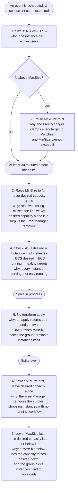

# Free-Tier Pre-provisioning Runbook

Before a known traffic spike, an operator raises the free-tier Auto Scaling Group's `MinSize` so
that the instances are already serving when the users arrive, and puts it back afterwards. This
runbook is that procedure, with the commands for production. Use it whenever an event with an
expected number of concurrent free-tier users is scheduled.

## Executive Summary

- **Why ahead of time.** Reactive scaling, the Free Manager following the active-user count,
  cannot serve the first wave of a spike: it runs every 5 minutes, a new instance takes several
  minutes to serve, and sticky sessions keep users on the instance where they landed.
- **Raise the floor, never desired capacity alone.** A desired capacity above the user-count
  target is a surplus, and the Free Manager removes it on its next run.
- **Ceiling first on the way up, floor first on the way back.** Lowering the floor leaves the
  choice of instances to the Free Manager, which never removes one running a workflow; lowering the
  ceiling below desired capacity leaves it to the group, blind to workloads.
- **No apply during the window.** An apply returns both bounds to the tfvars values.
- **Rehearsed on development** by [FREE_TIER_CAPACITY_REHEARSAL.md](FREE_TIER_CAPACITY_REHEARSAL.md),
  whose helpers can write to development only.

---

## Flow



---

## Before First Use on an Environment

The steps assume the Free Manager owns scale-in. An environment still on the earlier model has
the `-low` load alarms, which remove capacity themselves, blind to workloads:

```bash
aws cloudwatch describe-alarms --region ap-northeast-1 \
  --alarm-names subscr-optinist-cpu-low subscr-optinist-memory-low \
  --query 'length(MetricAlarms)'
# Expected: 0. Anything else: this runbook does not apply as written to that environment
```

---

## Steps

The commands name production's resources. In every terminal used:

```bash
export AWS_PROFILE=<the profile for the account hosting production>
source infrastructure/scripts/free_tier_capacity_helpers.sh   # for fts_prod_chain, read only
```

### 1. Record the starting bounds, and size the target

```bash
aws autoscaling describe-auto-scaling-groups --region ap-northeast-1 \
  --auto-scaling-group-names subscr-optinist-asg \
  --query 'AutoScalingGroups[0].[MinSize,MaxSize,DesiredCapacity]' --output text
# Expected: three numbers. Record MinSize and MaxSize as <min0> and <max0>
```

N = `ceil(expected concurrent users / 5)`, "concurrent" meaning a request within the Free
Manager's idle threshold (`FREE_IDLE_THRESHOLD_MINUTES`). More users than expected still get
capacity from reactive scaling, but only after a launch, and only in new sessions.

### 2. Raise the ceiling, if N is above `<max0>`

```bash
aws autoscaling update-auto-scaling-group --region ap-northeast-1 \
  --auto-scaling-group-name subscr-optinist-asg --max-size <N>
# Expected: no output; desired capacity unchanged
```

### 3. Raise the floor, at least 30 minutes before the spike

```bash
aws autoscaling update-auto-scaling-group --region ap-northeast-1 \
  --auto-scaling-group-name subscr-optinist-asg --min-size <N>
# Expected: no output; desired capacity becomes N within seconds and the difference launches
```

Each new instance waits about 300 s in `Pending:Wait` (the launch hook) while it boots and its
ECS agent registers; then ECS places its task. On development the group was settled about 7 to 9
minutes after this step. Production has not been measured, hence the 30 minutes.

### 4. Check it is serving

```bash
fts_prod_chain
# Expected, repeated until it holds: CHAIN OK at <N>
```

Settled means ASG desired capacity = instances `InService` = every instance in the group = ECS
desired count = ECS running count = healthy targets. An instance still draining stays in the
group, and the Free Manager keeps the ECS desired count at the group's instance count until it has
gone, so the running count alone can read settled too early.

```bash
aws cloudwatch describe-alarms --region ap-northeast-1 \
  --alarm-names subscr-free-manager-errors subscr-optinist-free-tg-unhealthy-hosts \
  --query 'MetricAlarms[].[AlarmName,StateValue]' --output text
# Expected: both OK
aws logs tail /aws/lambda/subscr-free-manager --region ap-northeast-1 --since 10m \
  --filter-pattern '"Calculated desired"'
# Expected: Calculated desired instances: <N> on each run
```

### 5. Hold it through the spike

**No `terraform apply` to production until step 7 is done.** Neither bound is under
`ignore_changes`, so an apply returns both to the tfvars values: the floor goes, and the Free
Manager scales in to the user count; and where the tfvars maximum is below the current desired
capacity, the group lowers desired capacity to it at once and terminates the difference itself,
newest instance first, whatever it is running.

The Free Manager keeps its target at N or above while the floor holds; more users than N × 5 raise
it further, up to `MaxSize`.

### 6. After the spike, lower the floor and leave desired capacity alone

```bash
aws autoscaling update-auto-scaling-group --region ap-northeast-1 \
  --auto-scaling-group-name subscr-optinist-asg --min-size <min0>
# Expected: no output; desired capacity unchanged until the Free Manager's next run
```

The next run computes the target from the user count and removes the surplus, choosing instances
with no running workflow. A surplus of 2 or more goes in one run; a surplus of exactly 1 waits for
three completed periods, about 15 minutes. Each instance leaves when ECS's draining hook completes.
On development the group was back at its baseline about 12 minutes after this step. A `-high`
alarm in `ALARM`, a workflow on every candidate, or the scaling lock (held for 15 minutes from
when it is set) delays it.

```bash
fts_prod_chain
# Expected, repeated until it holds: CHAIN OK at the user-count target; <min0> once the users have gone
```

### 7. Lower the ceiling last, if step 2 raised it

Only once desired capacity, the third number of step 6's chain line, is at or below `<max0>`:

```bash
aws autoscaling update-auto-scaling-group --region ap-northeast-1 \
  --auto-scaling-group-name subscr-optinist-asg --max-size <max0>
# Expected: no output; desired capacity unchanged
```

Never run it while desired capacity is above `<max0>`: the group would lower desired capacity to
`<max0>` and choose the instances itself. Applies may resume once the bounds are back at `<min0>`
and `<max0>`.

---

## Through tfvars Instead

`asg_min_size` and `asg_max_size` in the environment's tfvars survive applies, but every change
needs one. On the way up, one apply can raise both. On the way back, two applies, floor first:
`asg_min_size` lowered with `asg_max_size` still raised; then, once the Free Manager has brought
desired capacity to or below the old maximum, `asg_max_size` lowered. A single apply lowering both
would lower the maximum below desired capacity, and the group would choose.

---

## References

- [FREE_TIER_CAPACITY_REHEARSAL.md](FREE_TIER_CAPACITY_REHEARSAL.md) — these steps rehearsed on
  development at N = 3, with the reactive-scaling cases
- [FREE_MANAGER_ARCHITECTURE.md](FREE_MANAGER_ARCHITECTURE.md) — the Free Manager's scaling rules
- [TERRAFORM_ARCHITECTURE.md](TERRAFORM_ARCHITECTURE.md) — the ASG variables and `ignore_changes`
- Requirements and the rehearsal records: issue #890
