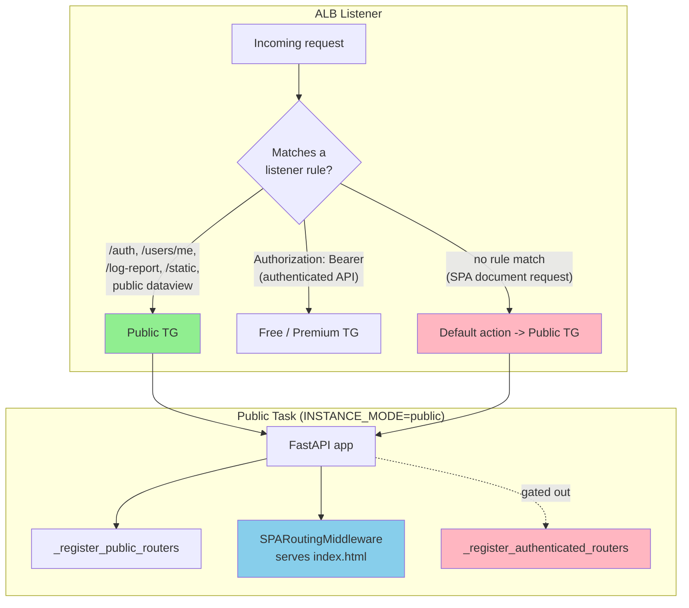
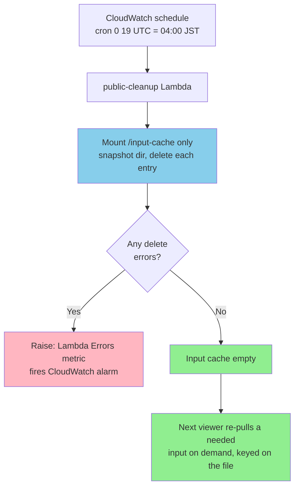

# Public Instance: SPA Shell and Bootstrap-Survival Tier

## Executive Summary

- **Public tier** is a dedicated always-on ECS service that runs the same image as the free/premium tiers with `INSTANCE_MODE=public`, serving the static SPA shell and a minimal API subset.
- **Router gating** drops the heavy workflow/optinist routers in public mode, keeping only the routers needed to load the app and authenticate.
- **Outage survival** means the SPA can boot and a user can log in even when the free tier is scaled to zero or unhealthy, instead of seeing a raw ALB 503.
- **Published-dataview reads** and the startup cache warm are served from public, decoupling unauthenticated visualization traffic from the authenticated tiers.
- **Host count** follows one value, the public service's desired count: ECS owns the public hosts through the tier's own capacity provider (see Host Count).
- **Shared task-definition values** are duplicated across `compute.tf`, `public_service.tf`, and `background_service.tf`; a shared value must be changed in all three.

---

## Key Architectural Principles

1. **One Image, Mode-Selected Behavior**
   - Every tier runs the identical container image.
   - The `INSTANCE_MODE` environment variable selects behavior at startup; only public tasks set `INSTANCE_MODE=public`.
   - Free, premium, and background tasks leave it unset and resolve to `default` (all routers registered).

2. **Public Is a Reduced API Surface, Not a Different App**
   - Public mode mounts only the routers required to bootstrap and authenticate the SPA plus the public-dataview reads.
   - Workflow, optinist, admin, and subscription routers are gated out, so unauthenticated traffic can never reach them on this tier.

3. **Bootstrap Survives a Free-Tier Outage**
   - `auth`, `users_me`, and `log-report` are served from public so login, the post-login bootstrap calls, and client-error reporting keep working when free is down.
   - The SPA shell loads from public regardless of the requested route, so the user gets the app frame and a graceful in-app error rather than a blank ALB 503.

4. **Static Delivery Is Coupled to Compute (Known Limitation)**
   - The SPA shell and static assets are baked into the image and served by the FastAPI process via `SPARoutingMiddleware`.
   - This is a pragmatic choice, not the long-term target; see Edge Case 5 and the future-work note.

---

## Architecture Overview



### Responsibility Matrix

| Responsibility | Public Tier | Free / Premium Tier | Background Tier |
|---|---|---|---|
| Serve SPA shell (`index.html`) | Yes - via default action | Yes - if request lands there | No |
| `auth` / `users_me` bootstrap | Yes - Primary (outage-safe) | Yes | No |
| `log-report` write | Yes - Exclusive (routed here) | No | No |
| Public dataview reads | Yes - Exclusive | No | No |
| Authenticated workflow/optinist API | No - Gated out | Yes - Exclusive | No |
| `/logs` viewer read | No | Yes - Owning tier only | No |
| Startup published-experiment cache warm | Yes - Exclusive (leader-elected) | No | No |
| Published input-cache cleanup (daily wipe) | Yes - via scheduled Lambda | No | No |
| Background scheduler jobs | No - Disabled | No | Yes - Exclusive |

---

## Implementation Details

### Instance mode selection

**File:** `studio/app/common/core/instance_mode.py`

Defines the `INSTANCE_MODE` env var name and its values. `INSTANCE_MODE_PUBLIC` (`"public"`) is set only on public tasks; everything else resolves to `INSTANCE_MODE_DEFAULT` (`"default"`).

### _register_public_routers()

**File:** `studio/__main_unit__.py`
**Purpose:** Mount the routers present on every tier so the SPA can bootstrap during a free-tier outage
**Input:** the `FastAPI` app
**Output:** `dataview.public_router`, `internal.router`, `outputs.router`, `auth.router`, `users_me.router`, `users_me.beacon_router`, `log_report.router` registered

### _register_authenticated_routers()

**File:** `studio/__main_unit__.py`
**Purpose:** Mount the workflow/optinist routers that are gated out of the public tier
**Input:** the `FastAPI` app
**Output:** algolist, experiment, files, logs, params, run, workspace, dataview, subscriptions, admin, hdf5/mat/nwb/roi, etc. registered

### _register_routers()

**File:** `studio/__main_unit__.py`
**Purpose:** Orchestrate registration by mode
**Input:** the `FastAPI` app, `instance_mode`
**Output:** always calls `_register_public_routers()`; returns early when mode is public, otherwise also calls `_register_authenticated_routers()`
**Calls:** `_register_public_routers()` -> `_register_authenticated_routers()`

### SPARoutingMiddleware

**File:** `studio/app/common/core/middleware/spa_routing_middleware.py`
**Purpose:** Serve `index.html` for browser document navigation (`Accept: text/html`) so React Router can handle client-side routes
**Input:** ASGI scope; intercepts when the request accepts `text/html` and is not a static/docs/health path
**Output:** `index.html` response with no-cache headers; otherwise passes through to API routes

### _should_run_startup_sync()

**File:** `studio/__main_unit__.py`
**Purpose:** Restrict the published-experiment cache warm to the public tier
**Input:** `instance_mode`, `is_standalone`
**Output:** `True` only when mode is public and not standalone; the warm itself is leader-elected across the ASG via `startup_sync_leader_lock()`

---

## Published Input Cache and Daily Cleanup

Published experiments are served from a cache on the shared **published-data EFS** filesystem rather than the lean root EBS, so both public tasks share one copy and it survives task replacement. Outputs and raw inputs sit under two separate EFS access points so they can be managed independently:

| Cache | Access point root | Container mount | Lifecycle |
|---|---|---|---|
| Output | `/` | `/app/studio_data/output` | Long-lived; holds the `remote_sync_stat.json` markers |
| Input | `/input-cache` | `/app/studio_data/input` | Wiped nightly; uid/gid 1000 so the container and the Lambda share one owner |

Raw inputs are synced on demand the first time an input node is viewed, so they are pure cache -- anything deleted is re-pulled from S3 on next access. To bound EFS growth, the **public-cleanup** Lambda wipes the input cache nightly while leaving the output cache and its sync markers untouched: it mounts only the `/input-cache` access point and its IAM is scoped to that access point, so it cannot reach the output cache.



The re-fetch in `get_structured_data()` -- and the sibling `get_csv()` / `get_image()` input branches -- calls `RemoteStorageDownloadUtils.ensure_input_file_synced()`, which downloads the single input file regardless of the experiment's output-sync status. That independence is what makes the daily wipe safe; see Edge Case 6 and `DATA_SYNC_ARCHITECTURE.md` for the status-gate interaction.

**Configuration:** `INPUT_CACHE_PATH` (default `/mnt/input`) is the Lambda's EFS mount path; the schedule is `cron(0 19 * * ? *)`; the timeout is 900s because EFS deletes are one round-trip per file.

---

## Host Count

The public tier runs one task per host: the static host port 8000 and the `tier == public` constraint leave room for one. ECS owns the hosts through the tier's own capacity provider, so the host count follows one value, the service's desired count.

| Part | Owner | What it does |
|---|---|---|
| Service desired count | Operator (`update-service`); the dev schedule at stop and start | The one value. Terraform sets it at creation only (`ignore_changes`) |
| Group desired capacity | ECS managed scaling, `aws_ecs_capacity_provider.public` at target capacity 100 % | One host per task: a task waiting in `PROVISIONING` adds a host, a host left empty is removed |
| Group min / max | Terraform, `public_asg_min_size` / `public_asg_max_size` | The floor and the ceiling; managed scaling stays between them |
| Which host goes on scale-in | ECS managed termination protection | The group launches every host protected; ECS lifts protection only from a host with no task |
| Health replacement | The group's `ELB` health check (see Health Checks) | Unchanged: scale-in protection does not stop a health replacement |

### Changing the count

```bash
aws ecs update-service --cluster <env>-optinist-cloud-cluster \
  --service <env>-public-optinist-cloud-service --desired-count <N> \
  --query 'service.desiredCount'
# Expected: <N>. The same command raises and lowers.
```

- **Up:** the extra tasks wait in `PROVISIONING`, ECS raises the group's desired capacity about a minute later, and each task starts once its host has booted and registered. The serving tasks are not touched.
- **Down:** ECS picks the tasks to stop, drains their targets for the target group's deregistration delay, then stops them. A host left with no task loses its protection. ECS lowers the group's desired capacity once those hosts have stayed empty for about 15 min, and the group removes them.
- **Stay between the floor and the ceiling.** Above `public_asg_max_size`, the extra tasks stay in `PROVISIONING`. Below `public_asg_min_size`, a host with no task stays registered in the target group, and the ELB check replaces it again and again.
- **Change the service, not the variables.** Raising `public_asg_min_size` alone adds hosts with no task, the case above.
- **An apply keeps the count.** Terraform ignores the service's desired count and the group's desired capacity, so a raise lasts until someone lowers it.
- **A known busy window:** raise before it and lower after it. Nothing schedules it yet.
- **Rollouts:** a rollout's extra task (maximum 200 %) can wait in `PROVISIONING` and make ECS add a host for the rollout. A host left empty afterwards goes as on scale-in.

Alarms during a change:
- `<env>-optinist-public-tg-unhealthy-hosts`: the group registers a new host as a target at launch, and the host fails its checks until its task serves, so the alarm fires on scale-out. On production it notifies the critical-alerts topic: tell the recipients before a raise.
- `<env>-optinist-public-serving-below-desired`: on scale-in the group's desired capacity stays up until ECS removes the emptied hosts, about the drain plus 15 min. That is inside its 35-of-40-minute window.

### Moving an existing environment to the provider

Once per environment whose public service still runs on launch type `EC2`. Terraform would replace that service, which stops every public task at once; `prevent_destroy` on the service turns that into a plan error. The service is switched with `update-service` between two applies:

1. **Create and attach the provider.** The service is not touched.

   ```bash
   terraform plan -target=aws_ecs_cluster_capacity_providers.main
   # Expected: aws_ecs_capacity_provider.public created; aws_autoscaling_group.public and
   # aws_ecs_cluster_capacity_providers.main updated in place (the list gains the public
   # provider and loses nothing); any other change is an in-place update the target's
   # dependencies carry; nothing destroyed. Then apply with the same -target.
   ```

2. **Switch the service.** A rolling deployment replaces its tasks one at a time.

   ```bash
   aws ecs update-service --cluster <env>-optinist-cloud-cluster \
     --service <env>-public-optinist-cloud-service \
     --capacity-provider-strategy capacityProvider=<env>-optinist-public-capacity-provider,weight=1,base=0 \
     --force-new-deployment --query 'service.capacityProviderStrategy'

   aws ecs describe-services --cluster <env>-optinist-cloud-cluster \
     --services <env>-public-optinist-cloud-service \
     --query 'services[0].deployments[].[status,rolloutState,runningCount,desiredCount]'
   # Expected once done: a single PRIMARY deployment, COMPLETED, running == desired
   ```

3. **Check the hosts that predate the provider.** The group protects only the hosts it launches from now on, and a host registered before the provider existed may not be associated with it.

   ```bash
   aws ecs describe-container-instances --cluster <env>-optinist-cloud-cluster \
     --container-instances $(aws ecs list-container-instances --cluster <env>-optinist-cloud-cluster \
       --filter 'attribute:tier == public' --query 'containerInstanceArns' --output text) \
     --query 'containerInstances[].[ec2InstanceId,capacityProviderName,runningTasksCount]' --output table

   aws autoscaling describe-auto-scaling-instances --instance-ids <the instance ids above> \
     --query 'AutoScalingInstances[].[InstanceId,ProtectedFromScaleIn,LifecycleState]' --output table
   ```

   - A host running a task, not protected: `aws autoscaling set-instance-protection --auto-scaling-group-name <env>-optinist-public-asg --instance-ids <id> --protected-from-scale-in`.
   - A host with no task: ECS removes it. If it is still there 30 min after the rollout, remove it by id: `aws autoscaling terminate-instance-in-auto-scaling-group --instance-id <id> --should-decrement-desired-capacity`.

4. **Apply the rest.** `terraform plan` shows no replacement of `aws_ecs_service.public`; a plan error that names `prevent_destroy` means step 2 did not take. Then apply.

---

## Edge Case Handling

### 1. Free Tier Scaled to Zero During Login

**Problem:** A user opens the app while the free tier is down; login and the post-login bootstrap calls would 503.

**Solution:** Auth and bootstrap routes are served from public:
- `/auth/*` and `/users/me/*` route to the public TG (ALB priorities 305, 306).
- The user logs in and the SPA bootstraps; premium users then provision via the normal assignment cascade.

### 2. SPA Document Request Lands on Public

**Problem:** A browser reload on `/workspaces/15` records a `GET /workspaces/15` on a public task, which looks like leaked authenticated traffic.

**Solution:** This is expected and serves only the static shell:
- Document navigation requests carry `Accept: text/html` and no `Authorization` header, so they miss every listener rule and fall through to the default action (public TG).
- `workspace.router` is not mounted on public, so `SPARoutingMiddleware` returns `index.html` (HTTP 200) with no user data.
- The booted SPA then issues authenticated XHR calls that carry the Bearer token and route to the owning tier.

### 3. Log Reporting vs Log Viewing

**Problem:** During a free outage, client-side errors would be lost and the log viewer would 503.

**Solution:** Split by direction:
- `/log-report/*` (write) routes to public so client errors still reach CloudWatch (ALB priority 307).
- `/logs` (read) stays on the owning tier so a user only ever sees their own tier's logs.

### 4. Public vs Own-Data Dataview Reads

**Problem:** `/outputs/*` is used both for public visualization reads and authenticated own-data reads.

**Solution:** Header-based carve-out:
- The frontend sets `DATAVIEW_PUBLIC_REQUEST: true` on reads originating from public pages; those route to public (ALB priority 280).
- Own-data reads fall through to the authenticated free rule (ALB priority 315).

### 5. Static Assets Served by Compute

**Problem:** A full FastAPI process sits in the request path purely to return static files (`index.html`, `/static/*`, `manifest.json`).

**Solution (current):** Static assets route to public via dedicated ALB rules, and the SPA shell is served by `SPARoutingMiddleware`. This works but is not optimal; the canonical pattern (future work) is S3 + CloudFront for the shell and static assets with CloudFront mapping 403/404 to `/index.html`, leaving the ALB/ECS tiers for API traffic only.

### 6. Input Cache Wiped While Output Still Marked Synced

**Problem:** The nightly cleanup deletes a raw input, but the experiment's `remote_sync_stat.json` -- on the un-wiped output cache -- still reads `success`. Gating the input re-fetch on that status (as the output-visualization sync path does) would short-circuit and serve a permanent 404 for input-node data.

**Solution:** Input re-fetch is decoupled from output-sync status:
- `get_structured_data()` and the `get_csv()` / `get_image()` input branches call `RemoteStorageDownloadUtils.ensure_input_file_synced()`, which downloads the input file by name regardless of sync status.
- A genuinely-absent input still returns 404; a remote-storage error returns 503.

---

## Monitoring and Metrics

| Signal | Source | Notes |
|---|---|---|
| Public access logs | `uvicorn.access` in `/ecs/<env>-public-optinist-cloud-taskdef` | Includes SPA shell document fetches, which resemble API hits |
| Target health | `aws_lb_target_group.public` health check on `/health` | ASG uses ELB health checks with a 900s grace period |
| Startup sync | application logs on the elected leader task | Non-leader tasks log "Startup sync deferred to leader task" |
| Input-cache cleanup failures | `<env>-public-cleanup-errors` alarm on the Lambda `Errors` metric | Fires on a crash/timeout or a non-zero delete-error count; daily `Sum`, `notBreaching` between runs |

Verify public targets are healthy after apply:

```bash
aws elbv2 describe-target-health \
  --target-group-arn <public_tg_arn> \
  --query 'TargetHealthDescriptions[*].[Target.Id,TargetHealth.State]' \
  --output table

# Expected: targets in "healthy" state
```

### Health Checks

The public and free ASGs both use `health_check_type = "ELB"`. Two layers judge health from the same target group:

| Layer | Judges | Grace counts from | Remedy |
|---|---|---|---|
| ECS service with `load_balancer` | task (TG + container check) | every task start | replace the task |
| ASG with `ELB` | instance (same TG) | first InService, once | replace the instance |

The ASG acts only on the target state `unhealthy`; `initial`, `draining` and `unused` are ignored.

**Why `ELB`, not `EC2`:** the target group is the only signal that replaces a host ECS cannot fix. A new instance that never gets a task, and a wedged host ECS keeps re-placing tasks onto (the only eligible one under the static port 8000 and the tier constraint), both stay forever under `EC2`.

**The cost:** past the ASG's 900 s grace, a task that restarts and does not serve within the target group window (public about 90 s, free about 300 s) gets its whole instance replaced, whatever the ECS grace says. On public the other host serves meanwhile; on free a task restart already loses every running workflow.

**Rejected:**
- `EC2`, with or without automated `set-instance-health`: an earlier attempt fought ASG scaling and was rolled back.
- `EC2` on public only: one host for an unbounded time, to save a half-capacity window of about 25 min per host replacement.
- A target group window wider than 900 s: the ALB would route users to a dead target for 15 min.

**What neither catches:** an agent lost after ECS deregistered the target leaves the host `unused`, not `unhealthy`. `<env>-optinist-{free,public}-serving-below-desired` covers it:

| Input | Metric | Why |
|---|---|---|
| desired | `AWS/AutoScaling` `GroupDesiredCapacity` (`Minimum`) | One task per host. Container Insights publishes no `DesiredTaskCount` while no task runs, so the tier losing its last task would read 0; the ASG publishes an explicit 0 when the dev schedule stops it |
| healthy | `AWS/ApplicationELB` `HealthyHostCount` (`Minimum`, `FILL` 0) | A wedged host keeps `RunningTaskCount` at desired; a deregistered target leaves a data gap, read as 0 |
| deploys | `ECS/ContainerInsights` `DeploymentCount` (`Maximum`) | A public rollout replaces its two tasks one at a time and is short a target for about 28 of 30 min, so the alarm is off while it exceeds 1 |

It fires on `desired - healthy > 0` for 25 of 30 one-minute periods on free and 35 of 40 on public, which outlasts each tier's longest normal gap outside a deployment. On free that is a single-instance refresh or a slow morning start, about 17 min. On public it is a host replacement, about 25 min on dev: the task waits out its 600 s drain, then the terminating instance's own 600 s drain, before it runs on the new host. A deployment that never finishes silences it; `tg-unhealthy-hosts` still fires if that deployment's target is unhealthy. Runbook: `MAINTENANCE_PROCEDURES.md`, *ALB Alarms*.

**Revisit the decision for a tier** if warm-host task restart to first healthy target has a p95 above about 60 s on public or about 240 s on free, or a prod instance replacement is traced to a slow restart. Options then: widen that tier's target group window (for example public `unhealthy_threshold` 3 to 5), make the restart faster, or build `EC2` with automated recovery as its own change.

---

## Configuration

| Variable | Purpose | Value on Public |
|---|---|---|
| `INSTANCE_MODE` | Selects tier behavior at startup | `public` |
| `DISABLE_BACKGROUND_SCHEDULER` | Disables the in-process scheduler | `1` |
| `SQLALCHEMY_POOL_SIZE` | DB connection pool size (small host) | `2` |
| `SQLALCHEMY_MAX_OVERFLOW` | DB pool overflow | `2` |
| `UVICORN_WORKERS` | Worker processes | `1` |
| `DB_HOST` | Database endpoint (via RDS Proxy) | `aws_db_proxy.main.endpoint` |

Stripe variables are intentionally omitted because the subscriptions router is gated out on public. The duplicated environment block is also present in `compute.tf` and `background_service.tf`; a shared value must be changed in all three task definitions.

---

## Key Functions Reference

| Function | File | Purpose |
|---|---|---|
| `_register_public_routers()` | `__main_unit__.py` | Mount routers present on every tier |
| `_register_authenticated_routers()` | `__main_unit__.py` | Mount routers gated out of public |
| `_register_routers()` | `__main_unit__.py` | Orchestrate registration by mode |
| `_should_run_startup_sync()` | `__main_unit__.py` | Restrict cache warm to the public tier |
| `SPARoutingMiddleware` | `spa_routing_middleware.py` | Serve `index.html` for browser navigation |

---

## AWS Resources

| Resource | Terraform | Notes |
|---|---|---|
| Target group | `aws_lb_target_group.public` | `/health` check, 600s deregistration delay |
| Launch template | `aws_launch_template.public` | `var.public_instance_type`, 30 GB gp3 root |
| Auto Scaling Group | `aws_autoscaling_group.public` | ELB health check, 900s grace, new hosts protected from scale-in, `AmazonECSManaged` tag, `OldestInstance` policy among unprotected hosts, `GroupDesiredCapacity` metric for the serving alarm |
| Capacity provider | `aws_ecs_capacity_provider.public` | Managed scaling at 100 %, managed termination protection, managed draining; attached by `aws_ecs_cluster_capacity_providers.main` (the default strategy stays free's) |
| Task definition | `aws_ecs_task_definition.public` | EC2/bridge, EFS published-data mounts (output + input cache) |
| ECS service | `aws_ecs_service.public` | Public capacity provider strategy, `tier == public` placement constraint, desired count set at runtime, `prevent_destroy` |
| Log group | `aws_cloudwatch_log_group.public_optinist` | `/ecs/<env>-public-optinist-cloud-taskdef`, 30-day retention |
| Input-cache access point | `aws_efs_access_point.published_data_input` | `/input-cache` subtree, uid/gid 1000; mounted at `/app/studio_data/input` |
| Cleanup Lambda | `aws_lambda_function.public_cleanup` | Daily input-cache wipe; VPC + EFS-mounted, 900s timeout |
| Cleanup schedule | `aws_cloudwatch_event_rule.public_cleanup_schedule` | `cron(0 19 * * ? *)` (04:00 JST) |
| Cleanup errors alarm | `aws_cloudwatch_metric_alarm.public_cleanup_errors` | Lambda `Errors` > 0; wired to `local.critical_alerts_actions` |

Public-bound ALB listener rules live in `infrastructure/terraform/public_alb_rules.tf`; see `ALB_ROUTING_ARCHITECTURE.md` for the full priority band.
