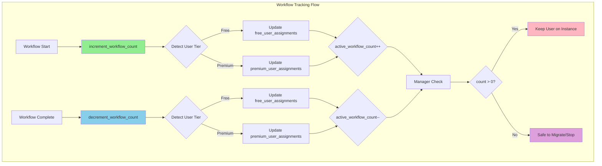

# Workflow Tracking: Active Workflow Protection for User Migration

## Executive Summary

- **Workflow Tracking** monitors active workflows for both free and premium tier users to prevent unsafe migrations
- **Atomic counting** ensures workflow count is always accurate despite concurrent operations
- **Manager integration** checks workflow count before any user migration or instance stop
- **Tier-aware routing** detects user subscription tier and updates the correct assignment table
- **Crash recovery** via Common User Manager resets stale counts using a two-condition inactivity check
- **Concurrent-run gate** refuses a run start at the plan's limit (`max_concurrent_workflows`, NULL = no limit); a lease renewed by live runs keeps a crashed run's count from locking a user out

---

## Key Architectural Principles

1. **Safe Migration for Both Tiers**
   - Track active workflow count per user in both `free_user_assignments` and `premium_user_assignments`
   - Managers NEVER migrate/stop users with active workflows (count > 0)
   - Prevents workflow interruption and data corruption

2. **Atomic Operations**
   - SQLAlchemy `update()` for atomic increment/decrement
   - Database handles concurrency, no application-level locks needed
   - `func.greatest(0, count - 1)` prevents negative counts

3. **Tier-Aware Tracking**
   - `_get_user_tier()` determines subscription tier via `SubscriptionService`
   - Updates the matching assignment table (free or premium)
   - Falls back to the other table if primary has no record
   - The release goes to the table the start was counted on, even if the plan changed during the run

4. **Crash Recovery**
   - Common User Manager runs every 10 minutes
   - Resets stale workflow counts only when user is inactive 2+ hours
   - Two recovery conditions: completed workflow with stale count, or workflow started 4+ hours ago

5. **Per-Plan Concurrent-Run Limit**
   - Limit: `subscription_plans.max_concurrent_workflows` of the user's plan (Free plan without a subscription); NULL = no limit
   - Check and increment are one conditional `UPDATE`: two simultaneous starts cannot both pass
   - Lease (`last_workflow_heartbeat`): renewed by live runs; an expired lease means no run is alive, so the gate restarts the count instead of refusing
   - Fails open: a lookup or database error starts the run uncounted

---

## Architecture Overview



### Responsibility Matrix

| Responsibility                | Workflow Tracking   | Free Manager        | Premium Manager     |
|-------------------------------|---------------------|---------------------|---------------------|
| Track active workflows        | Exclusive           | Never               | Never               |
| Update workflow count         | Atomic increment    | Never               | Never               |
| Check migration safety        | Never               | Reads count         | Reads count         |
| Decide to migrate/stop        | Never               | Exclusive (free)    | Exclusive (premium) |

---

## Implementation Details

### increment_workflow_count()

**File:** `studio/app/common/core/workflow/workflow_tracking.py`
**Purpose:** Atomically increment active workflow count for a user (free or premium), gated by the plan's concurrent-run limit
**Input:** `user_id` (from workflow context, `None` or standalone mode skipped)
**Output:** The tier counted on (`None` = not counted); sets `active_workflow_count`, `last_workflow_start` and `last_workflow_heartbeat`. At the limit: raises `WorkflowConcurrencyLimitError`, nothing counted
**Calls:** `_get_user_tier()`, `_get_concurrency_limit()` -> one conditional SQLAlchemy `update()` on `FreeUserAssignment` or `PremiumUserAssignment`

With a limit, the `UPDATE` matches only while `active_workflow_count < limit` or the lease has expired; an expired lease restarts the count at 1. MySQL assigns `SET` left to right, so the pin and count `CASE`s come before the heartbeat write.

### decrement_workflow_count()

**File:** `studio/app/common/core/workflow/workflow_tracking.py`
**Purpose:** Atomically decrement active workflow count, ensuring count never goes below 0
**Input:** `user_id` (from workflow context, `None` or standalone mode skipped); `tier` = what the increment returned (`None`: resolved now)
**Output:** Side effect - decrements `active_workflow_count` using `func.greatest(0, count - 1)` and sets `last_workflow_end`
**Calls:** `_get_user_tier()` (only without `tier`) -> SQLAlchemy `update()` on `FreeUserAssignment` or `PremiumUserAssignment`

### renew_workflow_lease()

**File:** `studio/app/common/core/workflow/workflow_tracking.py`
**Purpose:** Mark the user's counted runs alive
**Input:** `user_id`, `tier` (the counted table; `None` = no-op)
**Output:** Side effect - sets `last_workflow_heartbeat = NOW()`; errors are logged, not raised
**Called by:** `snakemake_execute` every `WORKFLOW_LEASE_RENEW_SECONDS` while the run lives; `WorkflowRunner.run_workflow` once before scheduling

### get_active_workflow_count()

**File:** `studio/app/common/core/workflow/workflow_tracking.py`
**Purpose:** Query current active workflow count for a user across both tiers
**Input:** `user_id`
**Output:** Integer count (0 if user not found or error)
**Calls:** `_get_user_tier()` -> SQLAlchemy `select()` on `FreeUserAssignment` or `PremiumUserAssignment`

### recover_stale_workflow_counts()

**File:** `infrastructure/terraform/common_user_manager_package/common_user_manager.py`
**Purpose:** Reset stale workflow counts for both free and premium users using a two-condition check
**Input:** None (reads from database directly)
**Output:** Dict with `free_recovered` and `premium_recovered` counts
**Calls:** SQLAlchemy `update()` on both `free_user_assignments` and `premium_user_assignments`

### Integration Points

- **`workflow_runner.py`**: Calls `increment_workflow_count()` in `__init__`, before any file of the run is written (a refused re-run leaves the experiment untouched); `release_workflow_slot()` releases a count that will not be scheduled; `run_workflow()` hands the counted tier to the executor
- **`snakemake_executor.py`**: Renews the lease while waiting on the run; calls `decrement_workflow_count(user_id, tier=counted_tier)` after execution completes (success or failure), and nothing for an uncounted start
- **`routers/run.py`**: Answers `WorkflowConcurrencyLimitError` with HTTP 429 (`detail` = `WorkflowConcurrencyLimitDetail` in `frontend/src/api/run/Run.ts`); releases the count when a start fails or is cancelled before scheduling

---

## Flow Diagram

### Workflow Tracking Flow

```
┌────────────────────────────────────────────────────────┐
│ 1. User Starts Workflow                                │
│    → WorkflowRunner.__init__() called                  │
│    → increment_workflow_count(user_id)                 │
└────────────────────────────────────────────────────────┘
                         ↓
┌────────────────────────────────────────────────────────┐
│ 2. Detect User Tier                                    │
│    → _get_user_tier() checks SubscriptionService       │
│    → Determines free or premium assignment table       │
└────────────────────────────────────────────────────────┘
                         ↓
┌────────────────────────────────────────────────────────┐
│ 3. Atomic DB Update (SQLAlchemy)                       │
│    → Increment active_workflow_count in correct table  │
│    → Set last_workflow_start = NOW()                   │
└────────────────────────────────────────────────────────┘
                         ↓
┌────────────────────────────────────────────────────────┐
│ 4. Workflow Runs (Snakemake Execution)                 │
│    → User is "protected" from migration                │
│    → Manager sees active_workflow_count > 0            │
└────────────────────────────────────────────────────────┘
                         ↓
┌────────────────────────────────────────────────────────┐
│ 5. Workflow Completes (Success or Failure)             │
│    → snakemake_execute() completion handler            │
│    → decrement_workflow_count(user_id)                 │
└────────────────────────────────────────────────────────┘
                         ↓
┌────────────────────────────────────────────────────────┐
│ 6. Atomic DB Update (with Safety)                      │
│    → Decrement using GREATEST(0, count - 1)            │
│    → Set last_workflow_end = NOW()                     │
└────────────────────────────────────────────────────────┘
                         ↓
┌────────────────────────────────────────────────────────┐
│ 7. Manager Can Migrate/Stop (if idle)                  │
│    → active_workflow_count = 0                         │
│    → No active workflows, safe to proceed              │
└────────────────────────────────────────────────────────┘
```

---

## Edge Case Handling

### 1. Concurrent Workflow Operations (Race Condition)

**Problem:** Two workflows start/end simultaneously for the same user.

**Solution:** Atomic SQL operations via SQLAlchemy `update()`:
- Database executes increment/decrement atomically
- No application-level locks needed
- `func.greatest(0, count - 1)` prevents negative counts on concurrent decrements

### 2. Workflow Crashes Without Cleanup

**Problem:** Workflow crashes before calling `decrement_workflow_count()`.

**Solution:** Common User Manager reconciliation:
- Runs every 10 minutes via scheduled Lambda
- Resets `active_workflow_count = 0` only when BOTH conditions are met:
  - User is inactive (`last_activity` > `WORKFLOW_USER_INACTIVITY_HOURS` ago)
  - AND either: workflow has completed (`last_workflow_end >= last_workflow_start`), OR workflow is very old (`last_workflow_start` > `WORKFLOW_VERY_OLD_HOURS` ago)
- Applies to both `free_user_assignments` and `premium_user_assignments`

The Lambda never resets an active user, so the concurrent-run gate does not rely on it: a crashed run stops renewing the lease, and once the lease is older than `WORKFLOW_LEASE_TTL_SECONDS` the gate restarts the count at the next start.

- All of a user's runs gone (deploy, instance replaced, worker killed): the slots return within the TTL
- One of several runs gone while another lives: that slot returns one TTL after the last live run ends
- A missed renewal (database unreachable for a TTL) can only admit a run early, never refuse one

### 3. Tier Detection Failure

**Problem:** `_get_user_tier()` cannot determine subscription tier (database error, missing user).

**Solution:** Fallback logic in tracking functions:
- If tier lookup fails, checks which assignment tables have records for the user
- Updates whichever table has a record (premium preferred if both exist)
- Logs warning but does not raise exception

### 4. Run Start at the Plan's Limit

**Problem:** A user starts more runs at once than the plan allows.

**Solution:** The conditional `UPDATE` matches nothing; the start is refused with HTTP 429 and a message naming the limit, how to free a place (wait or cancel), and the upgrade when another plan allows more. A refused start never falls back to the other table. A cancelled run frees its place once snakemake winds down (seconds).

### 5. Counted Start That Is Never Scheduled

**Problem:** The start is counted, then the input download, the sync lock or the client fails before the run is scheduled.

**Solution:** `routers/run.py` and `WorkflowRunner.__init__` call `release_workflow_slot()` on any failure or cancellation before scheduling. A start whose background task never runs is left to the lease.

---

## Free User Assignment Model

**File:** `studio/app/common/models/free_user.py`

| Field                    | Type             | Description                                      |
|--------------------------|------------------|--------------------------------------------------|
| id                       | BIGINT (PK)      | Auto-increment primary key                       |
| user_id                  | BIGINT (unique)  | Foreign key to `users.id`                        |
| instance_id              | VARCHAR(20)      | Assigned instance identifier                     |
| assigned_at              | TIMESTAMP        | When user was assigned to instance               |
| last_activity            | TIMESTAMP        | Last user activity (updated by heartbeat)        |
| active_workflow_count    | INTEGER          | Number of active workflows (default: 0)          |
| last_workflow_start      | TIMESTAMP        | Timestamp of last workflow start                 |
| last_workflow_end        | TIMESTAMP        | Timestamp of last workflow completion             |
| last_workflow_heartbeat  | TIMESTAMP        | Lease renewed by live runs (also on premium)     |
| migration_count          | INTEGER          | Number of migrations (for analytics)             |
| last_migration           | TIMESTAMP        | Timestamp of last migration                      |
| logged_out_at            | TIMESTAMP        | Explicit logout timestamp                        |

---

## Configuration

| Variable | Purpose | Default |
|----------|---------|---------|
| `WORKFLOW_USER_INACTIVITY_HOURS` | User must be inactive this long before stale count recovery | `2` |
| `WORKFLOW_VERY_OLD_HOURS` | Workflows older than this are assumed crashed | `4` |

**File:** `infrastructure/terraform/common_user_manager_package/common_user_manager.py`

| Setting | Purpose | Default |
|---------|---------|---------|
| `max_concurrent_workflows` (per plan) | Runs a user of the plan may have at once | `null` (no limit) |
| `WORKFLOW_LEASE_RENEW_SECONDS` | Lease renewal interval of a live run | `60` |
| `WORKFLOW_LEASE_TTL_SECONDS` | Lease age after which no run is alive | `600` |

**Files:** the tfvars `subscription_plans` entries (`max_concurrent_workflows`), and `studio/app/common/core/workflow/workflow_tracking.py` for the two constants.

To set or change a limit:

1. Set `max_concurrent_workflows` on the plan's tfvars entry (a whole number of at least 1; `null` = no limit; the variable's validation rejects anything else)
2. Apply. The task definitions carry the new `SUBSCRIPTION_PLANS_CONFIG`, and each container's start seeds it into `subscription_plans`
3. Describe the limit where the plans are described to users (the plan's `features` text)

The gate reads the row at every run start. An `UPDATE subscription_plans SET max_concurrent_workflows = …` takes effect at once, but the next container start re-seeds the row from the tfvars.

---

## Key Functions Reference

| Function | Purpose |
|----------|---------|
| `increment_workflow_count()` | Atomically increment count on workflow start (free or premium), refused at the plan's limit |
| `decrement_workflow_count()` | Atomically decrement count on workflow completion (free or premium) |
| `renew_workflow_lease()` | Mark the user's counted runs alive |
| `_get_concurrency_limit()` | The concurrent-run limit of the user's plan (`None` = no limit) |
| `get_active_workflow_count()` | Query current count for a user across both tiers |
| `_get_user_tier()` | Determine user subscription tier and check assignment records |
| `recover_stale_workflow_counts()` | Reset stale counts for both tiers (Common User Manager) |

---

## Monitoring and Metrics

### CloudWatch Logs

**Location:** Application logs (ECS container)

**Key Log Messages:**
```
Workflow count increment for user {user_id}: tier={tier}, has_free={bool}, has_premium={bool}
Incremented workflow count for user {user_id} ({table})
Workflow start refused for user {user_id}: {active} running, {plan} plan allows {limit}
Workflow count decrement for user {user_id}: tier={tier}, has_free={bool}, has_premium={bool}
Decremented workflow count for user {user_id} ({table})
Failed to renew the workflow lease for user {user_id}: {error}
```

### Metrics to Monitor

| Metric                          | Description                                      | Alert Threshold     |
|---------------------------------|--------------------------------------------------|---------------------|
| active_workflow_count_total     | Sum across all free and premium users             | > 100 (capacity)    |
| stale_workflow_count_recovered  | Counts reset by Common User Manager               | > 10 (crash issues) |

---

## AWS Resources

| Resource | Type | Purpose |
|----------|------|---------|
| `subscr-common-user-manager-schedule` | CloudWatch Event Rule | Triggers Common User Manager every 10 minutes |
